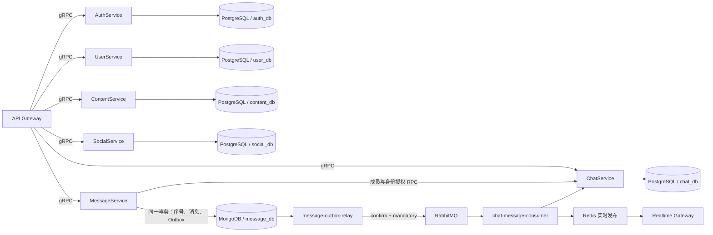

# 私聊阶段数据库迁移方案：PostgreSQL + MongoDB

日期：2026-10-19。状态：待实施设计方案。

本文根据当前仓库代码、数据库基线、13 个 Phinx 迁移、部署脚本和测试结构编写。本轮交付仅为方案；本文列出的新增类、配置项、脚本和测试均是实施任务，不表示已经完成。

## 1. 已确定的目标与本次边界

本次采用以下数据库分工：

| 服务 | 目标存储 | 拥有的数据 |
| --- | --- | --- |
| AuthService | PostgreSQL | devices、refresh_tokens、social_identities、social_identity_aliases、已有 Auth Outbox |
| UserService | PostgreSQL | users、personas、User Outbox |
| ContentService | PostgreSQL | posts、post_media、comments、Content Outbox |
| SocialService | PostgreSQL | likes、follows、blocks、已有 Social Outbox |
| ChatService | PostgreSQL | conversations、conversation_members、会话摘要与读游标、已有 Chat Outbox |
| MessageService | MongoDB | messages、conversation_sequences、消息 outbox_events |
| 基础设施 | Redis、RabbitMQ、对象存储 | 缓存与撤销状态、Worker ID 租约、实时状态、事件传输、媒体对象 |

当前只实现私聊。此次不增加群聊、聊天室成员角色、房间广播、消息分桶、在线分片路由、多地域多活等功能。保留 conversation_id 的领域含义，后续可以扩展会话类型。

目标是一次完成运行路径的替换，不长期维护三种生产数据库。MySQL 历史迁移和可选导入工具作为明确隔离的历史资料保留，生产启动路径不再依赖 MySQL。

项目尚未上线，采用可停止写入的切换方式，不引入在线双写和 CDC。未上线不等于数据可丢弃：需要保留的数据必须走第 14 节的导入与核对流程。



图中的 PostgreSQL 节点是服务的数据边界。第一版可以共用一个实例和一个物理数据库，通过独立 schema 与角色隔离；共用实例时仍共享资源。

## 2. 当前代码中已经确认的迁移点

| 当前位置 | 已确认的实现 | 迁移要求 |
| --- | --- | --- |
| `composer.json` | illuminate/database 12.x、Phinx 0.16、MongoDB PHP Library 2.1+ | 使用现有 Eloquent 的 PostgreSQL 能力；MessageService 直接使用官方 MongoDB Library |
| `packages/php/database/src/EloquentConnection.php` | 仅注册 MySqlConnection、SQLiteConnection；复用服务 PDO | 增加 PostgresConnection，保留共享事务与禁止隐式重放写入的策略 |
| `services/message-service/src/Application/MessageApplicationService.php` | 使用消息仓储和事务管理器接口，不直接持有 PDO | 保持应用层与存储边界分离 |
| 同上 | GetMessages 已按 conversation seq 游标分页，无总数查询 | 保持无 COUNT 的分页契约 |
| `services/message-service/src/Infrastructure/PdoMessageRepository.php` | 全仓调用点审计仅找到类定义 | 已删除未使用的 PDO/MySQL 消息仓储；生产只装配 MongoDB 实现 |
| `packages/php/outbox/src/OutboxRepository.php` | Eloquent + PDO；领取时检查同 event_key 的未发布前序 | PostgreSQL 继续使用 SQL 实现；MongoDB 另做实现并保留前序阻塞语义 |
| `packages/php/outbox/src/OutboxRelayStore.php` | 完成/失败操作只接收 id，未携带领取凭证 | 增加领取 token，防止旧 worker 修改重新领取的事件 |
| `packages/php/outbox/src/OutboxRelay.php` | 当前每轮领取一条，先发布再标记 | 复用流程，适配带 token 的领取结果 |
| `packages/php/outbox/src/RabbitMqEventPublisher.php` | 已启用 publisher confirm、mandatory、持久消息和失败抛出 | 两种 Outbox 复用现有发布协议与 RabbitMQ 实现 |
| `compose.yaml` | message-outbox-relay 复用 UserService 的 SQL relay 入口 | 消息 relay 改用自己的 MongoDB 入口；用户 relay 改 PostgreSQL |
| `services/social-service/src/Infrastructure/Repository/PdoSocialRepository.php` | 点赞捕获 1062 后在原事务查询；拉黑使用 ON DUPLICATE KEY | 以业务唯一键 ON CONFLICT 替换；不能把旧捕获流程原样移植 |
| `services/content-service/src/Application/ContentApplicationService.php` | 原生 PDO、反引号、1062、MySQL/SQLite 字符串精确比较分支 | PostgreSQL SQL、精确比较、条件更新与幂等恢复 |
| `services/chat-service/src/Infrastructure/PdoChatRepository.php` | 会话活动时间游标、last_message_seq 单调更新、已读上界校验 | PostgreSQL 类型转换后继续满足现有游标和摘要语义 |
| `services/user-service/src/Infrastructure/Migration/UserPhoneMigration.php` | 临时表、临时索引、仅 MySQL 分支加 FOR UPDATE | 显式实现 PostgreSQL 临时表生命周期和锁语义 |
| `database/migrations/20261018000000_preserve_refresh_revocation_precision.php` | revoked_at 已要求微秒精度 | PostgreSQL 必须保留 6 位精度 |
| `database/migrations/20261018000100_separate_refresh_logout_state.php` | logged_out_at 与 revoked_at 分离 | 基线包含两个独立字段，不从旧 revoked_at 推断 logout |
| `tests/Integration/ChatMessagePersistenceTest.php` | 当前使用两个 SQLite 内存库 | 增加真实 PostgreSQL + MongoDB 副本集测试，SQLite 不再证明消息持久化兼容性 |
| `.github/workflows/ci.yml` | MySQL 容器、pdo_mysql、SOCIAL_TEST_MYSQL_* 与 MySQL fixture | 替换基础设施、扩展、账户、变量和测试入口 |

现有业务规范以 `doc/USER_PERSONA_BUSINESS_RULES.md` 为依据。迁移不能通过减少身份检查或改变匿名展示来换取代码量下降。

## 3. 必须保持的业务与可靠性约束

| 编号 | 必须成立的约束 |
| --- | --- |
| I-01 | 可信 user_id 来自鉴权上下文；请求体不能指定消息的真实发送者 |
| I-02 | 发送及读取仍经过 ChatService 授权，授权失败或依赖不可用时按现有规则拒绝 |
| I-03 | MAIN/ALIAS、昵称、头像、匿名范围来自会话成员快照；迁移不刷新历史快照 |
| I-04 | 同一 sender_user_id + client_message_id 重试同一请求，返回相同 message_id 和 seq |
| I-05 | 同一个幂等键携带不同 conversation_id、type 或内容，返回 MESSAGE_DUPLICATE_CLIENT_ID |
| I-06 | 同一会话 seq 唯一且按成功写入推进；失败事务不能单独留下序号推进 |
| I-07 | 消息、序号、对应 message.created.v1 Outbox 原子提交或整体回滚 |
| I-08 | 只有确认提交后才向客户端报告成功，只有提交后的 Outbox 才能对外发布 |
| I-09 | RabbitMQ confirm 成功之后才能标记 Outbox published；未知结果允许重复，不允许直接丢弃 |
| I-10 | ChatService 重复或乱序收到事件时，摘要和 last_message_seq 不能回退 |
| I-11 | MarkRead 继续受已确认会话摘要上界约束；事件积压时保持现有同步后重试语义 |
| I-12 | PublicMessage 和事件公开投影不能暴露 ALIAS 的内部 user_id/persona_id |
| I-13 | IDs/seq 对外仍为十进制字符串；既有历史分页游标、Protobuf 和事件版本继续可用 |
| I-14 | User、MAIN、内部 ALIAS、注册事件原子创建；软删除身份不能通过重新创建绕过唯一约束 |
| I-15 | 刷新轮换、登出状态、撤销精度、设备隔离与 Redis 撤销持久性不得退化 |

seq 不新增“历史记录绝对无空洞”的承诺；已有空洞不补号、不重排。要求的是不重复、不回退、事务失败不产生独立的计数副作用。

## 4. 统一的类型与序列化规则

### 4.1 ID、seq 与整数

1. PostgreSQL 使用 BIGINT；MongoDB 使用 BSON Int64 保存 message_id、conversation_id、sender IDs、seq 与 last_seq。
2. API、事件公开 payload、领域 DTO 使用十进制字符串。数据库适配器负责转换，不把 BSON 对象泄露到传输层。
3. 不经过 float/JSON number 中转大整数，不把 MongoDB seq 保存为字符串后按字典序排序。
4. 在转换前验证 0..9223372036854775807；对象 ID 通常要求大于 0，读游标和计数允许 0。
5. 当前 Snowflake 使用 PHP 整数计算并返回字符串。预检仍要检查所有历史 ID 与计数，不能仅凭生成器设计假设历史数据全部合法。
6. 发现历史 UNSIGNED BIGINT 超过有符号范围时停止导入并出报告，另定 NUMERIC/Decimal128 兼容方案，禁止截断或自动转浮点。
7. 运行环境和测试统一为 64 位 PHP，覆盖 2^53 以上的 ID、18/19 位值、边界值及越界输入。

### 4.2 时间与精度

| 数据 | PostgreSQL | MongoDB / 对外格式 |
| --- | --- | --- |
| 普通 created_at、updated_at、会话时间 | timestamptz(3) | 消息使用 BSON UTCDateTime；映射为 UTC `Y-m-d H:i:s.v` |
| refresh_tokens.revoked_at | timestamptz(6) | 保留微秒，不转入 MongoDB |
| refresh_tokens.logged_out_at | timestamptz(6) | 保留微秒，不和 revoked_at 合并 |
| Outbox 调度、领取和发布时间 | timestamptz(3) | MongoDB 使用 BSON UTCDateTime |

MySQL 原 DATETIME 是无时区值，导入时按当前系统约定显式解释为 UTC，不能使用操作者电脑的本地时区。PostgreSQL 连接固定 UTC。

PostgreSQL 返回值可能带时区后缀、缺少尾部零或通过 Eloquent 转为日期对象，因此需要显式输出映射。当前 Chat 消费器验证毫秒时间字符串，不能把 `+00` 时间串直接装入 message.created.v1。

Auth 的微秒字段必须单独设置 Eloquent dateFormat/cast 与 SQL 参数精度。只改列类型、仍按毫秒写值不算完成。

### 4.3 JSON 与字符串相等性

- PostgreSQL 原有 JSON 列映射为 jsonb；普通帖子正文等原 TEXT 列仍保持 text。
- MongoDB 消息 content 第一版保存为合法 JSON 字符串，沿用现有 JSON 语义规范化比较，不为了使用文档库就改写公开消息结构。
- JSON 规范化比较已由与数据库无关的 MessageContentCodec 提供。
- `{}` 和 `[]` 必须不同；JSON 对象键顺序和空白不影响幂等；数组顺序继续有意义。数字行为以现有测试与规范化实现为基准，迁移不顺带改变数值等价规则。
- 不使用 hash 作为唯一的请求相等判据；如增加摘要，仅作为快速比较，最终规则仍可复核。
- sender、事件及公开投影中的大整数仍是字符串，不能因为 BSON/JSONB 转换而变成 JSON number。

### 4.4 状态值与比较规则

当前 TINYINT/SMALLINT 的业务状态与 0/1 标志优先保留为 SMALLINT + CHECK，避免一次迁移同时引入 PHP 布尔映射变化。需要转换为 boolean 的字段逐项修改模型 cast、SQL 和测试，不做批量替换。

OAuth provider_app_id、identity_namespace、subject_id、openid、unionid、匿名引用、client_message_id、幂等 request_id 等标识采用明确的区分大小写规则。PostgreSQL 使用确定性的比较，必要时指定 COLLATE "C"，MongoDB 业务唯一索引使用 simple collation。

邮箱等当前依赖 utf8mb4_unicode_ci 的人类输入，必须建立大小写、重音、Unicode 规范化的对照用例。`lower(email)` 不能被当作 MySQL Unicode 排序规则的完整等价替换。实施第 0 阶段需记录现有业务实际接受的邮箱范围和比较语义，选择显式规范化键或经过用例验证的 collation，并对历史冲突预检；禁止让数据库默认 collation 决定账号是否同一。

## 5. PostgreSQL 物理布局、角色与建表基线

### 5.1 第一版布局

建议一个物理数据库 `social_backend`，包含六个 schema：

```text
social_backend
  auth_db
  user_db
  content_db
  social_db
  chat_db
  meta
```

保留现有逻辑库名称便于审查。PostgreSQL 中不创建消息业务 schema；`message_db` 属于 MongoDB。五个服务分别通过自己的 schema 搜索路径访问数据，运行时不跨服务查表。

PostgreSQL 运行时和迁移使用固定服务 schema（`auth_db`、`user_db`、`content_db`、`social_db`、`chat_db`、`meta`）。CI 隔离使用独立数据库，不拼接 schema 前缀；设置非空 `PG_SCHEMA_PREFIX` 会快速失败。

### 5.2 角色设计

| 角色 | 允许能力 |
| --- | --- |
| 数据库初始化管理员 | 建数据库、角色、schema 和初始授权，不传入服务环境 |
| migration_ddl | 在目标 schema 执行版本化 DDL，拥有相应对象 |
| auth_runtime / user_runtime / content_runtime / social_runtime / chat_runtime | CONNECT、自有 schema USAGE、必要表 DML，不拥有对象、不具备 CREATE |
| user_outbox_relay | 仅 user_db.outbox_events 的查询与必要状态更新 |
| 测试角色 | 仅明确的 social_test_* 数据库或测试 schema，不共用生产管理员 |

显式检查 PUBLIC 权限、schema 搜索路径及默认权限。search_path 只包含受控 schema 与 pg_catalog，不把所有服务 schema 加入同一列表。未来新表的默认授权也必须纳入迁移。

只有实际使用数据库序列的角色才获得相应 sequence 权限。业务主键继续由现有 Snowflake 产生，不统一改为数据库自增。

### 5.3 新建 PostgreSQL 迁移目录

新增 `database/postgresql/migrations/`，Phinx 的 PostgreSQL 环境只扫描这个目录。原 `database/migrations/` 与 `infra/docker/mysql/` 保留为 MySQL 历史材料，不在 PostgreSQL 中逐条重放原生 MySQL 修复脚本。

建议将当前最终表结构整理为以下基线迁移，编号由实施时生成，不伪造历史已执行记录：

| 迁移 | 内容 |
| --- | --- |
| CreateAuthSchema | devices、refresh_tokens、social_identities、social_identity_aliases、完整约束与精度 |
| CreateUserSchema | users、personas、MAIN/内部 ALIAS 条件唯一索引、注册键 |
| CreateContentSchema | posts、post_media、comments、作者账号归属与匿名快照、请求幂等键 |
| CreateSocialSchema | likes、follows、blocks、目标类型与禁止自关注/自拉黑约束 |
| CreateChatSchema | conversations、conversation_members、私聊唯一键、last_message_seq 与快照字段 |
| CreateSqlOutboxes | 五个服务已有 Outbox 的最终字段、索引，以及新增 claim_token、lease_until、attempt_count |

schema、数据库及角色的引导需在 Phinx 运行前完成；meta.phinxlog 作为 PostgreSQL 自己的迁移账本，不复制 MySQL phinxlog 冒充已迁移。

Phinx 使用 pgsql adapter、schema=meta、migration_table=phinxlog、相同 PDO 连接。已核对当前 vendor 的 PostgresAdapter 支持 schema 和事务；实施时要用新测试确认日志表确实位于 meta。

### 5.4 关键约束映射

| 数据 | PostgreSQL 要求 |
| --- | --- |
| users.phone、email、social_registration_key | 保留可空唯一的实际业务含义；NULL 不能替换为空字符串 |
| personas MAIN | UNIQUE(user_id) WHERE type=1，包含软删除历史行 |
| personas 内部 ALIAS | UNIQUE(user_id) WHERE type=2 AND is_internal_alias=1，包含停用/软删除历史行 |
| personas 类型 | 保留 type 与 is_internal_alias 的 CHECK，不能让历史固定 ALIAS 变成内部身份 |
| social_identities | 保留 subject、provider app/openid、user/provider 的独立唯一键 |
| social_identity_aliases | 保留组合唯一键、大小写语义和当前外键行为 |
| posts/comments | 各自的作者账号 + request_id 唯一，NULL 仍允许无请求键 |
| likes/follows/blocks | 业务唯一键及 CHECK；ID 主键碰撞不能吞成业务幂等 |
| conversations | private_key 唯一，历史 NULL 可共存 |
| conversation_members | conversation_id + user_id 唯一，last_read_seq 非负 |
| conversations.last_message_seq | 非负，不因重复/乱序事件回退 |

示例：

```sql
CREATE UNIQUE INDEX personas_main_user_unique
    ON user_db.personas (user_id) WHERE type = 1;

CREATE UNIQUE INDEX personas_internal_alias_user_unique
    ON user_db.personas (user_id)
    WHERE type = 2 AND is_internal_alias = 1;
```

不要为这两个索引增加 deleted_at IS NULL 条件，这会削弱现有业务规则。部分唯一索引也不等于可通过 ON CONSTRAINT 名称引用的普通 UNIQUE 约束。

PostgreSQL 索引名在 schema 内唯一。MySQL 中 posts/comments 可以各自叫 uniq_author_request，迁移后应改为带表名前缀的不同名称。

### 5.5 迁移锁与 DDL

`phinx.php` 以同一 PDO 会话持有 PostgreSQL advisory lock。使用 pg_try_advisory_lock 配合有上限的等待循环，超时后明确失败，不无限等待。锁键稳定地对应数据库；CI 用独立数据库隔离。

移除 MySQL 的 GET_LOCK、RELEASE_LOCK、USE、MYSQL_ATTR_MULTI_STATEMENTS 及 CREATE DATABASE IF NOT EXISTS 逻辑。建数据库归基础设施初始化，schema 与表归各自的受控引导/迁移阶段。

普通基线 DDL 利用 PostgreSQL 事务回滚；未来需要 CREATE INDEX CONCURRENTLY 等操作时单独规划非事务迁移，不声称所有 DDL 都可放在事务中。

迁移过程中崩溃、锁超时、重复执行、结构漂移均需测试。IF NOT EXISTS 不能代替结构校验，已存在但类型、索引或 validator 不同的对象必须报告漂移。

## 6. PostgreSQL 连接与事务封装

### 6.1 连接工厂

新增 `packages/php/database/src/PostgresConnectionFactory.php` 或同目录等价实现，集中完成：

1. 从明确的 PG_HOST、PG_PORT、PG_DATABASE、PG_USER、PG_PASSWORD、PG_SCHEMA 读取配置。
2. 建立 pgsql PDO，启用异常和原生预处理，禁止持久连接的隐式跨生命周期共享。
3. 校验并设置受控 search_path、UTC 时区、application_name，以及连接/语句/锁超时。
4. 超时值由 RPC 剩余预算约束；启动就绪等待与请求内查询的超时分开。
5. 出错日志仅输出角色、目标与错误分类，不输出密码、完整 URI、SQL 参数或敏感身份数据。
6. 关闭或放弃连接时同步调用 EloquentConnection::forget，避免长驻 worker 保留失效连接。

五个服务的 bootstrap/server 和 User Outbox relay 统一使用此工厂，避免每个入口继续拼接 DSN。

### 6.2 EloquentConnection

- 增加 pgsql -> Illuminate\\Database\\PostgresConnection 分支。
- 保留当前自定义 handleQueryException 直接抛出的行为，避免断线后框架在未知提交状态下自动重放写入。
- 默认明确使用 READ COMMITTED，并逐项验证原 MySQL REPEATABLE READ 下的并发假设；需要更高隔离级别的操作单独选择，不全局强开 SERIALIZABLE。
- Eloquent 模型必须绑定到调用方同一个 PDO。User 写入与 User Outbox、Content 写入与 Content Outbox 要能一起回滚。
- 事务计数、嵌套事务与保存点由统一事务拥有者管理，不能一层原生 PDO 开事务、另一层误以为可独立提交。
- SQLite 只用于适合的轻量单元测试。生产路径不再接受 mysql 驱动，旧导入工具除外。

### 6.3 PostgreSQL 异常分类

| SQLSTATE | 分类 | 处理 |
| --- | --- | --- |
| 23505 | 唯一冲突 | 判断具体业务键；幂等命中或领域冲突，不能笼统成功 |
| 23503 | 外键冲突 | 数据/业务完整性失败，不当作重复请求 |
| 23514 / 23502 | CHECK / NOT NULL | 验证或内部数据错误，不进入幂等恢复 |
| 40001 / 40P01 | 序列化失败 / 死锁 | 已知回滚后，在请求预算内重试整个可重试事务 |
| 55P03 | 锁不可用/锁超时 | 按操作与剩余预算处理，不能无限重试 |
| 57014 | 取消或语句超时 | 停止当前操作，按 deadline 映射，不重新执行整段业务 |
| 08xxx | 连接失败 | 区分连接前失败与提交结果未知；后者不能自动重放 |
| 25P02 | 原事务已失败 | 修复事务控制流程，不能通过继续查询掩盖 |

增加统一的 PostgresErrorClassifier，正确解包 Illuminate QueryException 中的 PDOException。业务映射优先依靠显式 ON CONFLICT 目标及业务键，不解析本地化错误字符串来猜约束。

PostgreSQL 错误码与事务恢复依据：[SQLSTATE](https://www.postgresql.org/docs/current/errcodes-appendix.html)、[保存点与失败事务](https://www.postgresql.org/docs/current/tutorial-transactions.html)。

### 6.4 唯一冲突后的事务处理

明确禁止以下移植方式：INSERT 抛出 23505，catch 后立刻在同一失败事务中 SELECT。

按调用边界使用两种方式：

1. 预期业务键重复：优先使用有明确业务冲突目标的 ON CONFLICT DO NOTHING/DO UPDATE 与 RETURNING。
2. 必须捕获异常恢复：先回滚到自己拥有的保存点，或回滚最外层事务，再在有效事务中查询胜出记录。非事务拥有者不能擅自回滚外层业务。

在 READ COMMITTED 下，ON CONFLICT DO NOTHING 没有返回行时，用后续独立语句读取胜出行。不要默认把 INSERT 和读取塞进同一个 CTE 就一定能看见并发胜出者。

事务重试范围只包含已确认可回滚的数据库工作。包含外部 RPC、Redis 副作用、OAuth 调用的应用流程不能整体自动重试。

## 7. 五个 PostgreSQL 服务的逐项改造

### 7.1 AuthService

涉及 EloquentAuthRepository、EloquentSocialIdentityRepository、相关 Model 和 server.php：

- 将 23000/1062 检测改为 PostgreSQL 分类，分别处理设备、token_hash、OAuth subject、openid 别名与 user/provider 冲突。
- 审查 reserve、findByExternalIdentity、身份合并和别名写入是否可能处于已有事务；预期冲突使用目标明确的 upsert 或保存点。
- 所有身份 ID 的精确匹配保留大小写语义，不对 openid/unionid 等做小写化。
- 保留“身份行待注册—注册中—绑定成功”的状态机，不因新数据库将并发登录创建成多个账号。
- 保留 revoked_at/logged_out_at 的独立语义和微秒序列化；已有 revoked_at 不能被推断为一次可安全重试的登出。
- 重跑 refresh 轮换、并发登出、旧 access token 撤销恢复、设备隔离、OAuth 应用间 union/openid 合并与冲突测试。

### 7.2 UserService

涉及 EloquentUserRepository、EloquentPersonaRepository、EloquentTransactionManager、UserPhoneMigration 和 server.php：

- 注册相关唯一键冲突须先定位业务键，主键 ID 冲突不能当作“用户已存在”。
- 创建 User、MAIN、内部 ALIAS 和 User Outbox 必须共享同一 PostgreSQL 事务。
- MAIN/内部 ALIAS 的条件唯一索引包含软删除行；并发 ensureInternalAlias 继续复用同一身份，禁止复活停用身份。
- 手机号维护工具显式支持 PostgreSQL 的临时表、独立 CREATE INDEX、会话生命周期和 FOR UPDATE；报表不得包含完整手机号。
- 临时表只能操作明确创建的 pg_temp 对象，清理时不依赖可能解析到永久表的未限定名称。

### 7.3 ContentService

涉及 ContentApplicationService、server.php：

- 逐条修改原生 SQL 标识符，保留用户正文字符串，不做文件级盲目反引号替换。
- exactColumn 当前非 MySQL 分支使用 SQLite 的 COLLATE BINARY，不能给 PostgreSQL 复用；加入明确 PostgreSQL 精确比较实现。
- 发帖/评论的作者账号、request_id、身份模式、匿名昵称、媒体顺序等幂等比较规则继续有效。
- 保留条件更新：只有实际状态转换才能生成对应事件。不能仅凭 PostgreSQL rowCount 返回非零就认为状态发生变化。
- 删除评论时，评论状态、帖子计数和 Outbox 一起提交；主键/幂等冲突回滚后读取正确业务记录。
- 对可空列使用 IS DISTINCT FROM 或等价明确条件，避免 SQL NULL 比较改变状态转换判定。

### 7.4 SocialService

点赞建议使用：

```sql
INSERT INTO likes (id, persona_id, target_type, target_id, created_at)
VALUES (:id, :persona_id, :target_type, :target_id, :created_at)
ON CONFLICT (persona_id, target_type, target_id) DO NOTHING
RETURNING id;
```

有返回行才是新增点赞；无返回行是同业务键重复，必要时后续读取确认。其他唯一键，尤其 id 碰撞，继续报错。

- 用该方式替换“捕获 1062 + 原事务 FOR SHARE 查询”的 MySQL 当前读恢复流程。
- 拉黑使用 ON CONFLICT(blocker_user_id, blocked_user_id) DO NOTHING，不吞其他约束错误。
- 关注继续遵守现有 SOCIAL_ALREADY_FOLLOWED 等领域行为，不能统一改成无条件成功。
- 保留目标类型、禁止自关注/自拉黑的 CHECK 和双向账号拉黑含义。
- 如操作会写领域事件，只有新增/实际变化时写事件，并共享本服务事务。

### 7.5 ChatService

涉及 PdoChatRepository、ChatApplicationService、MessageCreatedHandler、bootstrap.php：

- PostgreSQL 保留 private_key 唯一；并发创建私聊时整体回滚失败事务，再查询已提交会话，不能返回部分成员数据。
- 确保会话与两个固定身份成员一起创建，历史匿名快照不重新查询当前昵称覆盖。
- 活动时间游标保持 UTC 毫秒字符串，COALESCE(last_message_at, created_at) + id 的排序与比较保持一致。
- applyMessageSummary 保留 WHERE last_message_seq < incoming_seq 的条件更新，重复/乱序事件不回退摘要。
- MarkRead 保持非成员拒绝、单调更新、不能超过已确认摘要；MongoDB 中已经存在但事件尚未消费的消息，仍按现有同步后重试策略处理。
- first-other-member 的私聊权限逻辑此次继续服务于私聊，不借迁移扩展为群聊。
- 如迁入历史数据，摘要回填由离线迁移工具协调完成，不能在 PostgreSQL 迁移里 JOIN MongoDB。

## 8. MessageService 的接口与代码边界

### 8.1 拆除应用层 PDO 耦合

建议新增以下契约，名称可以在实施时按仓库风格调整，职责不能合并丢失：

| 契约 | 职责 |
| --- | --- |
| MessageRepositoryInterface | 按发送者幂等键读取、按 seq 增量读取、按 message_id 读取历史页、查询最新 seq、准确计数 |
| MessageTransactionManagerInterface | 在操作预算内运行一项消息事务；管理 Session、提交、回滚和错误分类 |
| MessageWriteTransaction | 向事务回调提供查询幂等键、分配 seq、写消息、写 Outbox 的能力 |
| MessageContentCodec | 当前 JSON 内容验证与规范化比较，和数据库无关 |
| MessageDocumentMapper | 领域字符串/状态/快照与 BSON Int64、UTCDateTime 的双向映射 |

MessageApplicationService 负责校验、ChatService 授权、快照、幂等业务判断和 PublicMessage 投影；具体 MongoDB Session 只存在于 Infrastructure。

RoadRunnerMessageService 必须从项目实际可用的 gRPC deadline/超时上下文解析剩余预算，向应用服务、Chat RPC 和事务执行器传递同一 OperationBudget。预算用单调时钟计算，数据库阶段预留提交确认时间。若当前 RoadRunner 适配层不能直接取得标准 deadline，需明确补齐预算传播或设置不超过上游约定的服务内硬上限，并在 E2E 中证明行为；不能只增加一个没有接入传输层的超时类。

事务回调接收本次 MessageWriteTransaction，不使用全局静态 currentSession。该事务对象内部的消息仓储、计数器和 Outbox writer 都持有同一个 Session，避免任何一项写入遗漏 session 选项而落到事务外。

保留官方 MongoDB Library 的直接仓储实现，不额外引入 Laravel 应用容器或 MongoDB Eloquent 桥接层。当前项目是 Webman/RoadRunner，不为消息存储切换整个框架。

### 8.2 新实现与旧实现的生命周期

- 新增 MongoMessageRepository、MongoMessageTransactionManager、MongoMessageWriteTransaction、MongoOutboxRelayStore、MongoConnectionFactory。
- MessageApplicationService 不再暴露或调用 pdo()；GetMessages 以 conversation seq 游标分页，不执行总数 COUNT。
- 原 PdoMessageRepository 在调用点审计中没有调用者，已删除；旧 MySQL 迁移资料仍隔离保留。
- 单元测试改用内存仓储/事务 fake，只证明应用规则；MongoDB 原子性由真实副本集集成测试证明。
- 不新增生产双写开关。迁移期间运行两种实现是测试对照，不表示允许向两个事实源同时写消息。

## 9. MongoDB 数据库、集合、索引与权限

### 9.1 部署前提

数据库名为 message_db；测试使用独立 social_test_* 名称。第一版使用未分片副本集。

本地与快速 CI 可以使用单节点副本集，以验证真实事务；它不提供节点故障冗余。故障验证使用三个有投票权的数据节点，生产可用托管副本集或三个分布在独立故障域的数据节点。

连接 URI 显式配置 replicaSet、authSource 和 TLS（生产）。应用不使用管理员账户，不通过 directConnection 固定生产主节点。

普通 standalone 不满足多文档事务前提。来源：[MongoDB 事务部署要求](https://www.mongodb.com/docs/manual/core/transactions-production-consideration/)。

### 9.2 messages 集合

逻辑结构如下，类型标注不是可直接执行的 JSON：

```text
_id                       Int64        // 原 message_id
conversation_id           Int64
seq                       Int64
sender_user_id            Int64
sender_persona_id         Int64
sender_identity_mode      Int32
sender_display_name       string|null
sender_avatar_key         string|null
sender_anonymous_ref      string|null
sender_scope_type         string|null
sender_scope_id           string|null
client_message_id         string
type                      Int32
content                   string       // 合法 JSON 文本
created_at                UTCDateTime
schema_version            Int32
```

_id 直接使用现有 Snowflake 消息 ID，避免增加另一个与公开 message_id 无关的 ObjectId。仓储映射回领域数据时提供 message_id 字符串。

必要索引：

| 索引 | 用途 |
| --- | --- |
| MongoDB 默认 _id 唯一 | 消息主键 |
| UNIQUE(conversation_id, seq) | 会话内顺序与增量同步 |
| UNIQUE(sender_user_id, client_message_id)，simple collation | 完整保留当前跨会话幂等范围 |
| (conversation_id ASC, _id DESC) | 当前按 message_id 向前翻页的历史接口 |

sender_user_id + created_at 等索引只在存在对应读取接口或维护任务时增加。不能只复制所有历史 SQL 索引而不核对访问路径。

validator 约束必要字段、整数类型、seq > 0、身份模式及日期类型。内容的 JSON 合法性、字节长度和授权由应用层检查，validator 不替代应用校验。

### 9.3 conversation_sequences 集合

```text
_id          Int64          // conversation_id
last_seq     Int64
updated_at   UTCDateTime
```

_id 唯一。分配序号必须在消息事务内执行，逻辑相当于：

```text
findOneAndUpdate(
  {_id: conversationId},
  {$inc: {last_seq: Int64(1)}, $set: {updated_at: now}},
  {upsert: true, returnDocument: AFTER, session: currentSession}
)
```

不存在 last_seq 时，$inc 建立值 1。不同时在 $inc 和 $setOnInsert 中修改 last_seq，以免产生更新路径冲突。

第一次创建计数文档时的并发 _id 冲突，按计数器初始化竞争分类，在整体事务回滚后有预算地重试；不能误报为消息幂等冲突。

不使用 Redis INCR 代替此事务计数器，也不在事务外预分配一批 seq；此阶段优先保持当前原子性。

### 9.4 outbox_events 集合

```text
_id                 string         // event_id，沿用 UUID 字符串
conversation_id     Int64
message_id          Int64
message_seq         Int64
aggregate_type      string
aggregate_id        string
event_key           string
event_type          string
event_version       Int32
trace_id            string
payload             document       // 已生成的公开消息投影，ID 仍为字符串
status              Int32          // 0 pending / 1 published / 2 claimed
available_at        UTCDateTime
claimed_at          UTCDateTime|null
lease_until         UTCDateTime|null
claim_token         string|null
published_at        UTCDateTime|null
created_at          UTCDateTime
attempt_count       Int32
schema_version      Int32
```

必要索引：

- _id 默认唯一，保证 event_id 唯一。
- UNIQUE(conversation_id, message_seq, event_type)，保证同一消息的同类创建事件不重复。
- (status, available_at, created_at, _id)，支持扫描可领取事件。
- (conversation_id, status, message_seq)，支持未发布前序检查。
- (status, lease_until)，支持过期领取回收。

正常 message.created.v1 使用 conversation_id 字符串作为 event_key。排序使用 message_seq，不使用随机 UUID 的字典序，也不依赖不同发送进程的时钟先后。

payload 直接来自已有 PublicMessage 投影；不得把 MongoDB 完整消息文档直接当作事件 payload。

第一版不给 messages 设置 TTL。Outbox 如需清理，只清理超过保留期且已 published 的记录；pending/claimed 不能被 TTL 或批量清理删掉。清理保留期须覆盖故障调查与重放窗口。

### 9.5 初始化与最小权限

新增 MongoDB 版本化初始化工具，使用单独 schema_migrations 元数据集合、唯一版本号、校验和和带 token 的迁移锁。初始化步骤为：建集合、安装 validator、建索引、核验现有定义、记录成功版本。

MongoDB 集合和索引初始化不假设具有 PostgreSQL 式整批事务回滚能力。每一步需可重试；部分完成后再次执行必须核对并补全，发现不同索引或 validator 必须失败报告。

使用三个独立角色：

| 角色 | 权限范围 |
| --- | --- |
| message_runtime | 查询/插入 messages；查询及更新 conversation_sequences；插入 outbox_events；无 DDL、无消息删除权限 |
| message_outbox_relay | 仅查询和必要更新 outbox_events；无读取消息正文和计数器的额外权限 |
| message_migration | 集合、validator、索引与受控历史导入所需权限，不传给 worker |

MongoDB 迁移完成前不启动写入 worker。运行时不调用 createCollection/createIndex 做自动修复。

此阶段不启用分片。将来启用时必须重新审查全局 sender/client 幂等键和片键兼容性，不能把“未分片唯一键可用”当成已解决分片设计。

## 10. MongoDB 发消息事务与错误恢复

### 10.1 一次 SendMessage 的完整流程

1. 校验可信 user_id、conversation_id、client_message_id、类型、JSON 内容和长度。
2. 调用 ChatService 获取当前授权与不可变成员快照，构建发送身份；失败时不开始 MongoDB 写事务。
3. 快速查询 sender/client 幂等键。已存在且请求语义相同则返回旧消息；不同则返回 MESSAGE_DUPLICATE_CLIENT_ID。
4. 准备本次发送的 message_id、event_id、created_at 和快照；事务重试复用这些值。
5. 创建 Session，启动事务，事务内再次读取幂等键，避免并发重复。
6. 在同一 Session 递增 conversation_sequences，取得 seq。
7. 写入 messages，构建独立公开投影，写入 outbox_events。
8. 提交事务，确认成功后返回 PublicMessage。事务回调内不发 RabbitMQ、不写 Redis、不推送 WebSocket。
9. Session 在 finally 中结束。请求的中间结果不跨事务重试泄漏到返回值。

ChatService 授权与 MongoDB 提交之间仍存在跨服务的检查时差，这在当前 RPC 模式中已经存在。本次不承诺跨 PostgreSQL/MongoDB 的原子授权；保持发送前校验和推送前再次校验的现有语义。

### 10.2 事务选项

- readPreference=primary。
- 事务外的幂等快速查询、冲突后读取及其他成功结果确认，使用 primary + readConcern=majority，避免把尚未达到耐久确认的数据提前作为成功重放返回。
- 事务 readConcern=snapshot。
- 提交 writeConcern 使用 majority，并明确 journal 耐久配置；如显式使用 j=true，要在选定部署上验证支持。
- 事务涉及的所有操作显式使用同一 Client 创建的 Session。
- server selection、连接、socket、操作与提交等待均受请求预算约束；maxCommitTimeMS 不是整个请求的总超时。

写确认超时不能被当作“数据一定没写进去”。来源：[MongoDB Write Concern](https://www.mongodb.com/docs/manual/reference/write-concern/)。

### 10.3 使用有截止时间的 Core API 事务执行器

建议实现基于 Session::startTransaction/commitTransaction/abortTransaction 的 Core API 执行器，并用真实故障注入验证。

原因：官方 PHP with_transaction() 的当前便捷实现有固定、不可配置的 120 秒重试窗口，不能直接套在短 gRPC deadline 内。Core API 实现需遵守官方错误标签协议，而不是自行按异常文本重试。依据：[PHP with_transaction 行为](https://www.mongodb.com/docs/php-library/current/reference/function/with_transaction/)、[PHP Core API](https://www.mongodb.com/docs/php-library/current/crud/transaction/)。

重试规则：

| 情况 | 处理方式 |
| --- | --- |
| TransientTransactionError | 放弃当前已失败事务，有剩余预算时重跑整个事务回调 |
| UnknownTransactionCommitResult | 继续确认同一个事务的 commit；不能直接重新分配 seq、重跑发送流程 |
| 消息 sender/client 业务唯一键冲突 | 结束当前事务后读取胜出消息，比较完整请求语义，再返回或报领域冲突 |
| 计数器首次 upsert 的 _id 冲突 | 确认是该计数器初始化竞争后，回滚并有界重试 |
| message_id 主键碰撞 | 内部 ID 错误，不能返回其他消息，也不能伪装成幂等成功 |
| 普通参数、validator 或权限错误 | 失败并上报，不做事务重试 |
| 预算耗尽且提交结果仍未知 | 返回现有 RPC_TIMEOUT/SERVICE_UNAVAILABLE，保留未知结果语义，客户端继续复用同一 client_message_id |

整体重试初始上限可设为最多 3 次尝试，同时受更严格的剩余预算限制；commit 确认重试也在同一个总预算内。退避仅在剩余时间足够时执行，不延长原 RPC deadline。

提交结果未知时，不能因为一次读取暂时查不到消息就判定原事务一定失败。重试调用仍由全局幂等键和事务竞争收敛为同一结果。不能同时套用 120 秒便捷重试、应用三次重试和无界连接重试。

重试回调禁止网络副作用、外部 RPC、缓存失效、消息发布和“已发送”计数。ID、事件 ID 和时间在本次操作中稳定；seq 每次以事务内实际分配结果为准。

错误码继续使用现有契约：MESSAGE_DUPLICATE_CLIENT_ID=6001002、RPC_TIMEOUT=9001003、SERVICE_UNAVAILABLE=9001006 等。11000、112 等数据库错误不能直接作为业务错误码对外返回。

## 11. MongoDB Outbox 与消息发布进程

### 11.1 两种数据库共用的协议

保留 EventEnvelope、message.created.v1、producer=message-service、event_key=conversation_id、公开 payload 和 RabbitMqEventPublisher。

语义是至少一次发布：RabbitMQ 已接收但数据库未记 published 时，后续允许重发相同 event_id。不能承诺数据库与 RabbitMQ 之间 exactly-once。

### 11.2 领取凭证

建议新增 OutboxClaim，包含 OutboxRecord、claim_token、lease_until。OutboxRelayStore 改为：

```text
claimPending(limit) -> list<OutboxClaim>
markPublished(claim) -> bool
markFailed(claim, retryDelaySeconds) -> bool
releaseStaleClaims() -> int
```

markPublished/markFailed 的数据库过滤条件同时包含事件 ID、status=claimed 和 claim_token。返回 false 表示领取权已失效，旧 worker 不得覆盖新 worker 的状态。

SQL Outbox 同时增加 claim_token、lease_until、attempt_count 和相应 CAS 条件。过期回收以已记录的 lease_until 为依据，租期在 store 配置中统一确定，不再同时混用默认 300 秒年龄阈值。修改 OutboxEvent 模型、OutboxRelay、fake store 与测试，不保留一个可绕过 token 的生产无条件更新入口。

### 11.3 MongoDB 领取算法

第一版不额外引入每会话发布游标集合，直接保留当前“未发布前序阻塞”的规则：

1. 从 status=pending、available_at<=数据库当前时间的事件发现候选。
2. 在短 MongoDB 事务内检查同 conversation_id、message_seq 更小且 status 属于 pending/claimed 的事件。
3. 有未发布前序则跳过该会话，继续寻找其他会话；即使前序延迟重试或正在被别人领取，也不能越过。
4. 无前序时，对候选执行 status=pending 条件更新，写入新的 claim_token、claimed_at、lease_until、attempt_count。
5. 领取事务提交确认后，才把 OutboxClaim 交给发布器；候选竞争失败则继续调度。
6. 领取和更新必须使用同一 Session，事务冲突按有界重试处理。不能只先 find 再无条件 update。

候选扫描需要分页/扫描预算或经验证的聚合查询，不能只扫描被一个阻塞会话占满的前 50 条而让其他会话永久饥饿。前序查询使用状态集合和复合索引，必须用真实数据 explain 验证。

相同会话只有已确认发布的前序才允许后序领取；不同会话可由不同 relay worker 并行处理。

### 11.4 发布、确认、失败与过期回收

| 阶段 | 成功 | 失败/未知 |
| --- | --- | --- |
| 领取提交 | 获得有效 token 后发布 | 未确认领取不发布；已留下的领取等待租约回收 |
| RabbitMQ publish | 保留 confirm、mandatory 与持久标记 | NACK、不可路由、超时、断线均不标 published |
| 标记 published | CAS token 匹配时 status=1、写 published_at | 失败时允许之后重复发布；不能推断消息未进 broker |
| 标记失败 | 当前 token 匹配时回 pending，设置 available_at | token 失效时不修改新领取 |
| 进程崩溃 | 租约过期后重领 | 同 event_id 重发，消费者必须能去重/处理重复 |

租约使用数据库时间生成/比较，避免直接依赖不同 worker 的本地时钟。租期初值应明显大于当前 5 秒 publisher confirm 等待及数据库确认时间，再通过故障测试固定；长任务如需续租，续租也必须带 token。

数据库 token 只能阻止旧 worker 修改状态，无法撤销已经发往 RabbitMQ 的网络请求。进程暂停、租约过期后可能发生重复或迟到事件。因此消息 seq 是顺序依据，消费者/客户端继续处理重复与乱序，离线补拉使用持久化消息。此方案不声称故障期间 broker 观察到的物理顺序绝对严格。

无效 payload 或长期失败事件保留并告警，不能为了推进某个会话直接删除。故障重放工具必须使用原 event_id，并记录处理范围。

### 11.5 进程入口与部署装配

- 新增 `services/message-service/bin/outbox-relay.php`，只初始化 MongoDB Outbox store、RabbitMQ publisher、指标和受控重连循环。
- `compose.yaml` 的 message-outbox-relay command 指向新入口，移除它的 MySQL/PG 凭据与依赖，改为 MongoDB relay 专用凭据。
- `services/user-service/bin/outbox-relay.php` 改 PostgreSQL 工厂；不再作为消息服务的入口。
- 保留正常退出、异常关闭 AMQP channel/connection、重连退避、SIGTERM 处理与指标。
- 其他 SQL 服务已有 Outbox 结构继续迁移。本次只适配当前已装配的 User/Message relay；若为其他生产者新增 relay，必须列为单独接线与验收任务，不能把建了 Outbox 表等同于事件已在发布。

## 12. MongoDB 读取、分页和接口兼容

### 12.1 SyncMessages

使用 conversation_id + seq 的索引，返回 seq 升序、limit+1 判定 has_more。授权仍先经过 ChatService。

建议首版将单次同步页与 latest_seq 放在同一个短只读 snapshot 事务中读取，得到一致的可见窗口；如未来改为因果 Session 的高水位方案，须另行验证单调读及查询边界。

客户端的下一页 after_seq 应来自实际收到的最后一条消息；latest_seq 是同步高水位，has_more=true 时不能直接跳到 latest_seq。这一行为需加入接口回归用例，避免迁移后出现补拉漏消息。

latest_seq 来自已提交消息的最大 seq，不返回尚未提交的计数器值。空会话返回 "0"。

### 12.2 GetMessages

- 保留当前 `_id < cursor`、`_id DESC` 的 message_id 游标语义，不在同一迁移中悄悄改为 seq 游标。
- 仓储转换 ID 为 Int64 后查询，不能以字符串字典序比较。
- 保留 next_cursor、has_more 与 total 字段。total 使用准确 countDocuments，不替换成集合估算总数。
- 单次列表页与总数如要求一致，使用相同只读 snapshot 窗口；读取事务不混入外部 RPC。
- Snowflake message_id 顺序与会话 seq 顺序不是同一承诺，增量补拉以 seq 为准。
- 后续若要移除全量计数或修改排序，应作为单独 API 设计，不在此次迁移顺带进行。

### 12.3 类型与隐私回归

读取 MongoDB 后统一经 MessageDocumentMapper 和既有 PublicMessage 投影。单测覆盖 BSONInt64、UTCDateTime、null、空 JSON 对象、数组及匿名快照；事件 publisher 也使用相同公开投影规则。

MessageService 不直接读取 PostgreSQL 的会话/成员表；ChatService 不直接读取 MongoDB 的消息集合。跨库历史核对只属于离线迁移工具。

## 13. 运行依赖、配置与启动生命周期

### 13.1 PHP 与依赖

| 位置 | 任务 |
| --- | --- |
| composer.json / composer.lock | 增加 ext-pdo_pgsql、ext-mongodb、官方 mongodb/mongodb；锁定经过 PHP 8.4 验证的兼容组合 |
| infra/docker/php/Dockerfile | 安装 pdo_pgsql 和 mongodb 扩展；保留 Redis、bcmath、gRPC 等实际依赖 |
| MySQL 历史导入工具镜像 | 仅此可选工具保留 pdo_mysql；正常服务镜像不再需要它 |
| 本地 PHP / CI | 与容器验证同一扩展能力，不以 composer ignore-platform-reqs 掩盖缺失驱动 |

不为本次迁移升级 illuminate/database、Phinx 或 PHP 大版本。PostgreSQL、MongoDB、扩展与库使用受支持稳定版本，固定小版本/镜像摘要和锁文件，不使用 latest。PostgreSQL 可从 18.x 受支持版本建立验证基线；MongoDB 服务端和 PHP Library/扩展的具体组合在第 0 阶段通过官方兼容表与事务测试锁定。

### 13.2 环境变量

建议统一命名并明确每个容器实际获得的变量：

| 类别 | 变量 |
| --- | --- |
| PostgreSQL 公共连接 | PG_HOST、PG_PORT、PG_DATABASE（schema 使用固定服务名称） |
| PostgreSQL 单服务 | PG_SCHEMA、PG_USER、PG_PASSWORD，由 Compose 为每个服务分别注入 |
| PostgreSQL 迁移 | PG_MIGRATION_USER、PG_MIGRATION_PASSWORD、PG_MIGRATION_LOCK_TIMEOUT |
| MongoDB 应用 | MONGODB_URI、MONGODB_DATABASE、MONGODB_REPLICA_SET |
| MongoDB relay | relay 专用 MONGODB_URI，由其独立凭据构成 |
| MongoDB 初始化 | 独立管理员/迁移凭据和集群认证材料，不注入普通应用 |
| 数据库超时 | 明确命名的连接、选择节点、语句/操作、提交等待预算配置 |
| Outbox | 重试延迟、领取租期与发布超时，各自独立，单位写入变量名或配置说明 |
| 测试 | SOCIAL_TEST_PG_*、SOCIAL_TEST_MONGODB_*，替代 SOCIAL_TEST_MYSQL_* |

业务侧不再通过 MYSQL_* 决定数据库；PG_PASSWORD 不再兼任 MongoDB 或迁移账户密码。示例文件使用占位符，运行日志不打印含凭据的 URI。URI 的用户名/密码必须按 URI 规则编码，不能简单拼接含 @、: 等字符的密码。

### 13.3 Compose 服务

拟新增/调整：

- postgres、受控数据库/角色初始化步骤、postgres-migrate。
- MongoDB 副本集节点、本地 rs 初始化步骤、mongodb-migrate。
- 独立 message-outbox-relay command 与凭据。
- 在同一 Compose 网络内运行真实数据库集成测试的 test-runner。
- 原 database-migrate 若保留名称，必须明确它执行的是 PostgreSQL Phinx，不继续依赖 MySQL。

PostgreSQL 数据卷路径依据固定镜像版本的官方 PGDATA 布局配置；MongoDB 副本集配置内部成员认证和持久卷。旧 mysql_data 不进入自动清理步骤。

本地端口仅按需要绑定 127.0.0.1。服务间使用内部 DNS；副本集广播的成员 hostname 必须能被客户端解析。真实集成测试优先放在 Compose 网络中，避免宿主机拿到 mongo:27017 等不可解析地址。生产 URI 不用 directConnection 规避错误的拓扑配置。

PostgreSQL 保持 synchronous_commit=on，不通过关闭耐久确认换取跑分。若生产要求主节点故障后也不丢已确认写入，需要同步复制及相应故障切换策略；普通异步副本或备份不自动提供该保证。第一版是否共用实例、是否配置同步副本，要在部署设计中记录 RPO/RTO，而不是由数据库名称推断可用性。依据：[PostgreSQL 主备与同步复制](https://www.postgresql.org/docs/current/warm-standby.html)。

### 13.4 启动阶段顺序

```text
构建含新扩展的 runtime
  -> 启动 PostgreSQL / MongoDB 进程 / Redis / RabbitMQ
  -> 引导 PostgreSQL 数据库与角色
  -> 引导 MongoDB 副本集并等待 PRIMARY、创建受控账户
  -> 初始化 RabbitMQ 拓扑
  -> 执行 PostgreSQL Phinx
  -> 执行 MongoDB validator / index 版本化初始化
  -> 进行连接、权限和事务能力预检
  -> 启动五个 PostgreSQL 业务服务及 MessageService
  -> 启动 Outbox relay 与 chat-message-consumer
  -> 启动/开放 Gateway 并执行端到端验证
```

MongoDB 进程可连接、replica set 已 PRIMARY、集合迁移完成是三个不同阶段。初始化不能依赖一个“必须先存在 PRIMARY”但又阻止 rs-init 运行的 healthcheck，避免启动依赖死锁。

首次镜像 init 脚本只处理空卷；已有卷的账户、授权、schema/index 升级由可重复的显式初始化/迁移任务处理。

### 13.5 就绪与长驻 worker

- PostgreSQL 就绪检查不仅 SELECT 1，还验证服务角色能访问其必要业务表、search_path 正确且不存在未结束事务。
- MongoDB 就绪检查验证能选择 writable primary、必要集合迁移已由启动门禁完成、应用具备必要读写权限。事务能力由启动预检和集成测试验证，不在每次健康探测中写入假业务消息。
- 可通过现有 RoadRunnerHealthService 的 readinessChecker 注入依赖检查；保留鉴权与 Worker ID 租约检查。
- 如运行时读取迁移元数据，单独授予该元数据的最小只读权限，不授予整个其他业务 schema/集合的访问权。
- Session 按请求/事务创建和结束，不在 worker 请求之间复用活跃事务；Mongo Client/PDO 按进程生命周期管理。
- 失败或超过 deadline 的事务不能残留到下一个 RPC。连接状态不确定时丢弃本次会话/连接，由已有生命周期重新建立。
- readiness 失败应返回可识别状态，不把数据库完整错误和连接凭据暴露给公网。

### 13.6 Makefile 与脚本

增加 pg-ready、mongo-ready、migrate-pg、migrate-mongo、test-postgres、test-mongodb、test-cross-store 等明确目标；make migrate 串行执行两类迁移，任一步失败则不启动业务写入。

同步修改 run_migrations.sh、test_deployment_lifecycle.sh、e2e_test.sh、social_e2e_test.sh、chat_message_rpc_probe.php、cr05_rpc_fixture.php、cr05_rpc_stack.ps1 及实际涉及数据库 fixture 的延迟探针。

scripts/auth_latency_probe.sh 与 verify_token_latency_probe.php 的数据库描述/fixture 也要核对，不能只改应用服务。ShardRouter 中 message_mysql_default 需清除过时名称；本次不把它变成实际 MongoDB 分片路由，也不修改已生成的 Protobuf 代码。

自动流程不执行 make clean 或 docker compose down -v。保留旧数据卷是切换与恢复的一部分。

## 14. 空环境与历史数据的迁移流程

### 14.1 路径 A：新环境、新数据

适用于确认无需导入既有业务数据的独立开发/测试环境：

1. 使用新的 PostgreSQL/MongoDB 数据卷或独立数据库名。
2. 执行基础设施初始化、两类基线迁移。
3. 导入新的受控测试 fixture。
4. 运行完整数据库集成和端到端测试。
5. 通过后把该环境标记为新存储栈。

不需要先删除旧 MySQL 卷。新建环境和销毁旧环境是两项独立操作。

### 14.2 路径 B：保留现有数据

新增明确的离线导入工具，使用独立只读 MySQL 来源账户和受控目标导入账户。工具具备 dry-run、分批检查点、可恢复导入、校验报告和来源/目标标识。

预检清单：

- 来源已实际应用的迁移版本、结构漂移与目标映射；不能只按最早 init SQL 假设最终表结构。
- 所有 ID/seq 是否在目标 Int64 范围，是否存在负数、无效字符串或主键重复。
- 唯一键、MAIN/内部 ALIAS、用户注册键、OAuth 别名和外键是否符合最终约束。
- 文本是否有效 UTF-8，是否包含 PostgreSQL text/jsonb 无法接受的 NUL；JSONB 数值、SQL NULL 与 JSON null 是否能保持语义。
- 大小写、尾随空格、重音及 Unicode 规范化是否会在目标比较规则下产生冲突。
- 消息是否具有完整会话身份快照；消息 seq、计数器与会话摘要是否一致。
- revoked_at/logged_out_at 的精度与数据含义；不得推导丢失的 logout 信息。
- 每个待发布消息事件是否能映射到对应消息、seq 和公开 payload。

发现问题必须报告并停止对应导入步骤，不能自动小写标识符、重建匿名快照、补造登出时间、重新生成历史 ID 或悄悄丢记录。

### 14.3 停写导入顺序

1. 关闭外部写入口，停止业务写入、Outbox relay 与消费者；确认旧栈不再变更。
2. 备份 MySQL、记录 RabbitMQ 队列和事件处理状态，保留 Redis 撤销数据及 Worker ID 配置。
3. 生成一致的来源快照与 manifest；旧服务保持停止，不能在导入时继续写来源。
4. 创建 PostgreSQL 最终结构与 MongoDB 集合/索引。
5. 导入 Auth/User/Content/Social/Chat 数据，保留所有原始 ID、NULL、快照和时间精度。
6. 导入 MongoDB messages、conversation_sequences 与消息 Outbox。
7. 从权威消息记录计算每个会话最大 seq/最后一条消息，核对或受控回填 PostgreSQL 摘要；检查 last_read_seq 不超过已确认范围。
8. 执行数量、键、时间精度、快照内容与事件完整性核对。
9. 启动目标服务，先做只读/小范围发送验证，再启动 relay/consumer 验证追平。
10. 验收通过后开放写入，记录明确的切换时间点与目标版本。

### 14.4 消息与 Outbox 导入细则

- 消息 _id 使用原 message_id，seq 和 sender/client 幂等键完全保留。
- last_seq 至少覆盖已存在消息最大 seq；来源计数器更高时保留并报告原因，不直接下降或补填历史空洞。
- 原 event_id、trace_id、event_key、payload、published 状态和 available_at 保留。不要重新生成“等价事件”。
- 旧 claimed 事件仅在确认旧 relay 全部停止后重置为 pending，清除旧 token/租约；允许重复发布。
- published 事件保持 published，不为历史消息无条件再发通知。
- 同一会话摘要、消息内容、匿名作者快照需逐项可核对；只对比总行数不算迁移成功。
- MySQL phinxlog 作为来源 manifest 的审计材料保留，不写成 PostgreSQL/MongoDB 的执行历史。
- 导入断点使用稳定主键/复合游标，重复批次不能覆盖不同内容；目标键存在时先比较一致性。
- 报告记录计数和脱敏校验值，不输出手机号、token、OAuth 凭据或完整消息正文。

### 14.5 回退边界

开放新栈写入之前，可以停止目标服务并恢复原版本/原卷，前提是队列和 relay 状态一起受控恢复。

开放新栈写入之后，旧 MySQL 已不是最新事实源。直接切回旧版本会丢失新增消息、关系及认证状态，必须先停写并制定反向导出/补偿、事件状态核对和去重方案；不能把“旧卷还在”当作无损回退保证。

因此正式切换前应在独立环境演练完整导入和恢复。此项目未上线，不需要为本次任务引入长期双写，但需要保存一次切换记录与恢复步骤。

## 15. 文件级任务清单

以下“新增”均为拟新增文件，不表示当前仓库已经存在。

| 范围 | 文件/目录 | 具体工作 |
| --- | --- | --- |
| 依赖 | composer.json、composer.lock | MongoDB 官方库与两个目标扩展要求 |
| 镜像 | infra/docker/php/Dockerfile | 编译安装目标扩展，验证 PHP 平台要求 |
| PG 工厂（新增） | packages/php/database/src/PostgresConnectionFactory.php | 角色、schema、UTC、超时和 PDO 初始化 |
| Mongo 工厂（新增） | packages/php/database/src/MongoConnectionFactory.php | URI、拓扑、认证、预算与 Client 初始化 |
| SQL 封装 | packages/php/database/src/EloquentConnection.php | PostgresConnection 与共享事务 |
| SQL 分类（新增） | packages/php/database/src/PostgresErrorClassifier.php | SQLSTATE 解包、约束/重试分类 |
| 消息契约（新增） | services/message-service/src/Domain/Repository/ | 读取、写事务与事务管理契约 |
| 消息实现（新增） | services/message-service/src/Infrastructure/Mongo/ | 仓储、事务管理、写事务上下文、文档映射、Outbox store |
| 内容比较（新增） | services/message-service/src/Application/MessageContentCodec.php | 提取现有 JSON 规范化规则 |
| 消息应用 | services/message-service/src/Application/MessageApplicationService.php | 移除具体 PDO 仓储、直接事务和 COUNT SQL |
| 消息入口 | services/message-service/bin/server.php | Mongo 依赖装配、readiness 与预热 |
| 消息传输与授权 RPC | services/message-service/src/Transport/Grpc/RoadRunnerMessageService.php、Infrastructure/GrpcChatMemberSnapshotClient.php | 传递剩余 deadline、取消/超时与授权调用预算 |
| 消息 relay（新增） | services/message-service/bin/outbox-relay.php | Mongo Outbox 与 RabbitMQ 发布进程 |
| Outbox 公共契约 | packages/php/outbox/src/OutboxRelayStore.php、OutboxRelay.php | 带 token 的领取、完成与失败 |
| Outbox 领取对象（新增） | packages/php/outbox/src/OutboxClaim.php | 封装记录、token、租期 |
| SQL Outbox | packages/php/outbox/src/OutboxRepository.php、Model/OutboxEvent.php | PostgreSQL 锁、claim_token 与 CAS |
| 用户 relay | services/user-service/bin/outbox-relay.php | 使用 PostgreSQL 工厂 |
| Auth 持久层 | services/auth-service/src/Infrastructure/Repository/ 与 Model/ | 唯一冲突、身份合并、时间精度 |
| User 持久层 | services/user-service/src/Infrastructure/Repository/ | 唯一键、条件索引对应行为、原子注册 |
| 手机号维护 | services/user-service/src/Infrastructure/Migration/UserPhoneMigration.php | PG 临时表、锁、清理与隐私报告 |
| Content | services/content-service/src/Application/ContentApplicationService.php | SQL、exactColumn、条件更新和幂等 |
| Social | services/social-service/src/Infrastructure/Repository/PdoSocialRepository.php | 目标明确的 ON CONFLICT/RETURNING |
| Chat | services/chat-service/src/Infrastructure/PdoChatRepository.php、Application/ | 时间映射、游标、并发私聊和摘要 |
| 五服务入口 | auth/user/content/social 的 bin/server.php、chat 的 bin/bootstrap.php | 统一 PostgreSQL 依赖装配 |
| 就绪 | packages/php/grpc-common/src/Health/RoadRunnerHealthService.php 及注入处 | 复用 checker，按服务验证真实存储依赖 |
| PG 迁移（新增） | database/postgresql/migrations/ | 五业务 schema 的最终基线与 SQL Outbox |
| Mongo 迁移（新增） | database/mongodb/migrations/、scripts/migrate_mongodb.php | validator、索引、版本账本、漂移检测 |
| 迁移配置 | phinx.php、scripts/run_migrations.sh | pgsql adapter、meta 账本、PG advisory lock |
| PG 引导（新增） | infra/docker/postgresql/ | 数据库、角色、schema 与默认权限 |
| Mongo 引导（新增） | infra/docker/mongodb/ | 副本集、账户、认证、就绪阶段 |
| 数据导入（新增） | scripts/import_legacy_databases.php 等明确的离线工具 | dry-run、检查点、导入、核对、manifest |
| 编排 | compose.yaml、Makefile | 依赖顺序、新卷、迁移 gate、专用 relay 和测试目标 |
| 环境样例 | .env.example、.env.production.example | 拆分凭据与目标变量，移除正常运行所需 MYSQL_* |
| CI | .github/workflows/ci.yml | PostgreSQL、MongoDB 副本集、扩展、真实集成与故障验证 |
| 脚本/探针 | scripts/ 的数据库 fixture、生命周期、E2E、PowerShell 工具 | 改目标连接、账号、就绪与延迟统计描述 |
| 静态配置 | phpstan.neon、必要 baseline、tests/bootstrap.php | 新类型、autoload 与测试初始化；不靠扩大忽略掩盖错误 |
| 说明文档 | README.md、五服务和消息 README、scripts/README.md、相关 doc | 新栈启动、迁移、恢复、已知语义及历史说明 |

不编辑 contracts/gen 下的生成代码。历史 MySQL 文档和导入工具可以出现 MySQL 字样，但正常启动、连接、CI fixture 不能残留隐式 MySQL 依赖。

## 16. 测试设计与验收矩阵

### 16.1 测试层次

| 层次 | 环境 | 证明什么 |
| --- | --- | --- |
| 单元测试 | 内存 fake，必要的 SQLite 辅助 | 业务校验、公开投影、JSON 比较、错误分类、领取 token 传递 |
| PostgreSQL 集成 | 真实 PostgreSQL + 服务运行角色 | 原生 SQL、约束、锁、保存点、时间精度、迁移和最小权限 |
| MongoDB 集成 | 真实已初始化副本集 | BSON 类型、索引、事务、Session 绑定、并发幂等、回滚和领取 |
| 跨存储集成 | PostgreSQL + MongoDB + RabbitMQ + Redis | 服务边界、Outbox 发布、摘要、推送与补拉 |
| 故障测试 | 三节点 MongoDB、副本切换或受控网络代理 | 提交未知、主节点切换、崩溃恢复、重复事件和丢失响应 |
| 完整 E2E | 新栈真实 Gateway/gRPC/业务服务 | 登录、私聊、发送、拉黑、匿名投影、重连补拉和健康探测 |

数据库必须是真实例，不能用 SQLite 的 SQL 兼容结果代替 PostgreSQL，也不能用 mock 的 commit 返回成功证明 MongoDB 事务成立。

### 16.2 MongoDB 消息事务

| 编号 | 场景 | 验收结果 |
| --- | --- | --- |
| M-01 | 正常发送一条消息 | 一条消息、一次 seq 推进、一条创建事件；返回值类型正确 |
| M-02 | 相同 sender/client、相同内容串行重试 | message_id/seq 一致，消息和 Outbox 不增加 |
| M-03 | 相同 sender/client、JSON 空白/对象键顺序不同 | 按当前内容规范化规则返回相同消息 |
| M-04 | 同幂等键内容/type/会话不同 | 返回 6001002，不写入新记录 |
| M-05 | 多进程并发相同幂等键 | 所有最终确认的成功结果指向同一消息，只有一条 Outbox |
| M-06 | 多进程不同幂等键、同会话发送 | 最终确认写入的消息 seq 唯一、按会话推进，消息/事件数量匹配 |
| M-07 | 多会话并发 | 不共享错误计数器，不发生跨会话幂等污染 |
| M-08 | 计数器首次创建竞争 | 正确重试，不误报消息重复，不产生孤立序号 |
| M-09 | 递增后抛错 | 消息、序号、Outbox 全部回滚 |
| M-10 | 插入消息后、Outbox 前抛错 | 消息和序号一起回滚 |
| M-11 | Outbox 写入失败或 validator 拒绝 | 三项都不提交，返回失败 |
| M-12 | 事务回调因 transient error 重跑 | ID/快照/时间稳定，最终只留一份数据 |
| M-13 | commit 响应丢失 | 重试同一事务确认，或返回未知结果；再次同 client ID 调用收敛到一条消息 |
| M-14 | 真实 primary stepdown | 预算内恢复或明确可重试失败，最终不丢已确认消息、不重复写入 |
| M-15 | 人工制造 message_id 主键碰撞 | 内部错误，不泄露另一个消息、不当幂等成功 |
| M-16 | 大于 2^53 的 ID/seq | 字符串/BSON Int64 往返无精度损失，排序正确 |
| M-17 | 截止时间用尽 | 请求不被 120 秒隐藏重试拖住，不残留活跃 Session/事务 |
| M-18 | 一次写入故意遗漏或混用 Session | 测试能发现原子性被破坏；正常实现所有写入绑定同 Session |

并发测试使用进程屏障/受控竞争点，避免只靠随机 sleep。对超时/提交未知的请求，用原幂等键做最终核对，不能只统计拿到成功响应的请求就推断所有数据库结果。

### 16.3 Outbox 与 RabbitMQ

| 编号 | 场景 | 验收结果 |
| --- | --- | --- |
| O-01 | 两个 relay 同时领取同一候选 | 仅一个有效领取 token 可推进状态 |
| O-02 | 同会话前序 pending 且重试时间在未来 | 后序仍被阻塞，其他会话能发布 |
| O-03 | 同会话前序 claimed | 后序不能越过；候选扫描不使其他会话饥饿 |
| O-04 | worker 领取后崩溃 | lease 到期后可恢复，相同 event_id 发布 |
| O-05 | A 租约过期，B 重领，A 恢复 | A 的 markPublished/markFailed 均无法改写 B 的状态 |
| O-06 | RabbitMQ 不可路由或 NACK | 事件不标 published，保留重试信息 |
| O-07 | broker 已确认，数据库标记失败 | 允许重复事件，消息与摘要不重复/不回退 |
| O-08 | 领取提交结果未知 | 未确认的 worker 不擅自发布；过期状态可回收 |
| O-09 | 标记 published 的结果未知 | 重试/恢复不丢事件，不无条件覆盖新的 token |
| O-10 | poison event | 记录、告警、可重放；不自动删除跳过 |
| O-11 | 重复/乱序事件到 ChatService | 摘要保持最大 seq，公开推送可去重并支持补拉 |
| O-12 | 旧 worker 的网络发布迟到 | 消费端以 seq/事件 ID 处理，不把数据库 token 当作 broker fencing |
| O-13 | 负载下有大量已发布历史 | 前序查询与领取有可验证索引计划，没有全历史无界扫描 |
| O-14 | PostgreSQL Outbox 两 worker 竞争 | SKIP LOCKED、前序阻塞、token CAS 与 Mongo 实现满足同一公共契约 |

### 16.4 PostgreSQL 业务与迁移

| 编号 | 场景 | 验收结果 |
| --- | --- | --- |
| P-01 | 原生 PDO 与 Eloquent 共用事务 | 任一业务/Outbox 写失败全部回滚 |
| P-02 | 同手机号/注册键并发注册 | 一套 User、MAIN、内部 ALIAS 和相应事件 |
| P-03 | 主键冲突与 CHECK/FK 冲突 | 不被误判为注册或点赞幂等 |
| P-04 | MAIN/内部 ALIAS 软删除或停用后重建 | 唯一约束与业务禁用规则仍生效 |
| P-05 | OAuth subject/openid 大小写、别名合并 | 和既有身份语义一致，无跨账号误合并 |
| P-06 | 并发点赞、关注、拉黑 | 正确业务结果，事务不残留 25P02 |
| P-07 | 发帖/评论同请求键、不同参数 | 返回既有幂等冲突，不覆盖内容或媒体顺序 |
| P-08 | 删除评论与帖子计数/Outbox | 同一事务提交，失败后锁释放且计数恢复 |
| P-09 | 状态无变化的 UPDATE | 不额外产生事件 |
| P-10 | 并发创建同一私聊 | 一个会话、两个正确成员快照，无半成品会话 |
| P-11 | 会话列表分页与同毫秒时间 | 游标稳定合法，时间字符串满足既有校验 |
| P-12 | MarkRead 重试、回退值、超界值 | 单调更新，超界拒绝，不越过已确认摘要 |
| P-13 | revoked_at/logged_out_at 微秒边界 | 精度往返和登出重试边界不退化 |
| P-14 | 手机号维护临时表 | FOR UPDATE 生效，重复执行无永久临时表污染，无完整号码日志 |
| P-15 | 基线首次运行、再次运行 | 结构正确、幂等、不重建数据、不伪造旧迁移历史 |
| P-16 | 迁移中途失败/进程退出 | 事务回滚或明确恢复步骤，锁释放，可再次执行 |
| P-17 | 第二个迁移进程 | 等待/超时符合配置，不并行修改 schema |
| P-18 | 同名错误索引/列类型/validator | 报告漂移，不以 IF NOT EXISTS 忽略 |
| P-19 | 服务运行角色越权访问/DDL | 访问其他业务 schema、建删表等被拒绝 |
| P-20 | 大整数、NULL、Unicode 与大小写 | 数据与业务键行为满足第 4 节，错误数据在导入前被阻止 |

### 16.5 跨服务与公开契约

| 编号 | 场景 | 验收结果 |
| --- | --- | --- |
| X-01 | 真身/匿名身份发起私聊并发送 | 从会话快照投影，消息体不能切换身份 |
| X-02 | 非成员、伪造 user/persona、跨会话匿名引用 | 拒绝且不写消息，不泄露内部身份 |
| X-03 | 双向拉黑/身份停用 | 发送和推送前授权符合现有规则 |
| X-04 | 提交后暂停 Chat 消费器 | 消息可按授权补拉，摘要暂时滞后，恢复后追平 |
| X-05 | 重复事件与消费者崩溃重试 | 消费器正常恢复，摘要不回退，未处理事件可重试/重放 |
| X-06 | 多页同步时并发新消息 | 页窗口与 latest_seq 一致，按实际最后 seq 继续不会漏读 |
| X-07 | 历史页与 total | 当前 message_id 游标、字段类型和准确计数保持兼容 |
| X-08 | WebSocket 断线/在线 PubSub 丢包 | 重连后持久化补拉可恢复；不把在线通道当离线事实源 |
| X-09 | 存储断线与服务重启 | readiness 不虚报，连接和 Session 不泄漏，恢复后原幂等键可重试 |
| X-10 | 整栈迁移后登录/刷新/登出 | 认证和 Redis 撤销状态无回归 |

### 16.6 现有测试的调整清单

| 现有测试 | 处理 |
| --- | --- |
| ChatMessagePersistenceTest | 改为真实 PostgreSQL Chat + MongoDB Message；可将应用规则拆回 Unit |
| MessageSessionSecurityTest | 使用仓储/事务 fake 检查身份与幂等；事务持久性断言迁到 Mongo 集成测试 |
| EloquentPersistenceTest、UserOutboxTransactionTest | 转为 PostgreSQL，验证相同 PDO 与回滚 |
| EloquentOutboxConcurrencyTest、OutboxRelayTest | PG 并发、Mongo 公共契约、token 丢失及失败恢复 |
| EloquentSocialIdentityRepositoryTest、UserSocialRegistrationConcurrencyTest | PostgreSQL 真实唯一键、保存点和身份合并 |
| PdoDeviceIsolationTest、AuthLogoutRecoveryTest、AuthWarmPathLatencyTest | 更换连接/fixture，保留认证隔离、恢复与延迟验证 |
| ContentPersistenceConcurrencyTest、ContentAuthorizationTest | PostgreSQL SQL、状态转换、计数与事务回滚 |
| SocialLikeConcurrencyTest | 从 MySQL 当前读技巧切换为 PG ON CONFLICT 的并发行为 |
| PhinxMigrationTest | 改为 PG 元数据、事务、schema、锁与最终基线；保留历史导入用例的独立归属 |
| MySqlLeastPrivilegeTest / MySqlLeastPrivilegeConfigTest | 改为 PostgreSQL 角色验证，另加 Mongo 最小权限用例 |
| PersonaIdentityMigrationContractTest | 验证目标条件索引与软删除语义，不继续断言 MySQL 生成列文本 |
| UserPhoneMigrationTest | 验证 PostgreSQL 临时表、锁、冲突报告和隐私规则 |
| HealthRetryTest、部署生命周期测试 | 新依赖、PRIMARY/迁移 gate、断线恢复与超时预算 |
| probe/E2E/配置契约测试 | 使用新变量和目标环境，不靠跳过集成测试通过 CI |

新增 MongoMessageTransactionTest、MongoMessageIdempotencyConcurrencyTest、MongoOutboxConcurrencyTest、MongoTransactionFailoverTest、PostgresLeastPrivilegeTest、MongoLeastPrivilegeTest、CrossStorePrivateChatTest 等聚焦测试，具体命名在实施时统一。

## 17. CI、验证命令和通过标准

### 17.1 CI 作业

1. PHP lint、PHPStan、现有适用 Unit、Go vet/test。新接口的类型问题在这里解决。
2. PostgreSQL 集成：真实基线迁移、业务仓储、并发、角色、微秒与迁移锁测试。
3. MongoDB 集成：初始化副本集与目标账户，验证事务/索引，再执行消息与 Outbox 并发测试。
4. 跨存储集成/E2E：完整 PHP/Go 服务与 RabbitMQ/Redis，执行私聊、消息、摘要、推送、补拉和授权测试。
5. 故障作业：三节点副本集/受控代理，验证主切换与未知提交。可作为独立必需作业，不能用单节点测试宣称已验证故障切换。

CI 环境缺少目标数据库或驱动时，相应集成作业失败，不通过 markTestSkipped 使迁移看似完成。SQLite 测试只标记其实际覆盖的业务逻辑。

故障工具只在测试基础设施启用；生产不开放 failpoint/管理员诊断入口。模拟异常标签的单测用于分类，不能替代真实 commit 响应丢失的测试。

### 17.2 拟提供的命令

以下是实施后应具备的入口，目前仍是方案中的新增/调整目标：

```text
make build-runtime
make infra-up
make pg-ready
make mongo-ready
make migrate-pg
make migrate-mongo
make test-unit
make test-postgres
make test-mongodb
make test-cross-store
make test-database-failover
make analyse
make e2e
```

Makefile 负责实际依赖顺序与失败退出，不能要求操作者凭记忆先执行某个隐藏的 rs.initiate 或建索引命令。

### 17.3 容量与延迟验证

不在没有结果时承诺固定 QPS。为私聊准备以下可重复负载：

- 多会话均匀发送，观察整体写吞吐与 MongoDB transaction 冲突。
- 单会话集中发送，观察 seq 竞争、重试和端到端延迟。
- 相同 client ID 的并发重试，确认重试风暴不制造额外消息。
- 消费器暂停后恢复，检查 Outbox 积压追平、PG 摘要写入和推送延迟。
- 大量历史记录下按 seq 补拉、按 message_id 翻页及准确 total 的查询计划。

记录迁移前同一数据与负载的基线，再对比 P50/P95/P99、成功率、超时率、CPU、I/O、索引大小和事件延迟。SLO 以项目实际 RPC deadline 与现有探针门槛为准，先固定目标再测试，不在结果出来后放宽门槛。

## 18. 建议实施顺序与每阶段出口

| 阶段 | 实施内容 | 必须通过的出口 |
| --- | --- | --- |
| 0：冻结契约与盘点 | 确认源数据保留范围、邮箱比较语义、版本组合、时间/ID规则、现有延迟基线 | 数据与约束映射清单、兼容版本锁定、业务回归用例确定 |
| 1：目标基础设施 | PHP 扩展、PG/Mongo 容器与角色、初始化、迁移 gate | 空环境重复启动成功；Mongo 真实事务可用；服务角色无 DDL |
| 2：PG 基线与公共层 | 六个 schema、最终约束、Phinx 锁、PDO/Eloquent/错误分类 | 基线、漂移、时间精度、共享事务、角色测试通过 |
| 3：五个 PG 服务 | Auth/User/Content/Social/Chat 的 SQL、异常与 bootstrap | 现有业务和并发用例在 PG 上通过，没有无效事务恢复 |
| 4：消息契约与 Mongo 仓储 | 应用层解耦、BSON 映射、索引、事务、读窗口与分页 | 消息幂等、回滚、排序、隐私及 deadline 测试通过 |
| 5：两类 Outbox | 公共 claim token、PG CAS、Mongo 前序检查、消息专用 relay | 并发领取、过期恢复、重复发布与 RabbitMQ confirm 测试通过 |
| 6：整栈接线 | Compose/Makefile/CI/探针、RabbitMQ 消费、Gateway | 跨库私聊 E2E、认证回归、补拉与健康恢复通过 |
| 7：历史数据演练 | dry-run、导入、核对、停写切换与恢复演练 | manifest 和核对无未处理差异；新数据回退边界写清楚 |
| 8：故障与容量门禁 | 提交未知、主切换、进程崩溃、积压、冷热数据负载 | 无丢失已确认消息、无幂等破坏，延迟/恢复符合预定目标 |
| 9：切换与收尾 | 目标栈写入、文档、依赖残留检查、旧资料隔离 | 正常启动不依赖 MySQL，验收清单完成，旧数据保留策略明确 |

这些阶段可拆成独立可审查提交/PR。中间提交允许在迁移分支逐步开发，但旧消息服务仍需要 MySQL 时，不应把中间状态作为完整目标部署交付。

预计工作量最大的部分是消息事务失败路径、两种 Outbox 的一致性协议，以及现有 MySQL 并发/迁移测试的替换。具体工期应在第 0 阶段和基础设施冒烟完成后估算，不能按“换两个依赖”估时。

## 19. 监控、运维与验收定义

### 19.1 必需监控

| 对象 | 指标/事件 |
| --- | --- |
| MongoDB 事务 | 成功/回滚、整体重试次数、commit 重试、提交未知、deadline 耗尽、写冲突、复制延迟 |
| 消息幂等 | 重放命中、内容冲突、主键碰撞分类；不以用户/会话 ID 建无限指标标签 |
| MongoDB 读取 | 补拉与历史查询耗时、扫描/返回比、total 计数耗时 |
| PostgreSQL | 查询延迟、连接数、锁等待、死锁、事务时长、autovacuum/膨胀、复制与备份状态 |
| 两类 Outbox | backlog、最老未发布年龄、领取冲突、租约回收、token 失效、发布失败、确认延迟 |
| Chat 消费器 | 消费滞后、摘要推进、重复/旧 seq、失败队列与重放次数 |
| 请求链路 | 发送到持久化确认、到摘要、到在线推送的分段延迟 |

日志通过 trace_id、request_id、event_id 关联，故障报告不包含连接秘密、token、完整消息内容或内部匿名身份映射。需要定位单个会话时使用受控日志查询，不能把所有会话 ID 放入监控标签。

### 19.2 恢复与日常维护

- PostgreSQL 与 MongoDB 分别建立备份及恢复验证；以停写时间点和来源 manifest 协调跨库一致性，不假设两份独立快照天然处于同一业务时刻。
- RabbitMQ 的积压、已发布但未消费、失败队列与数据库 Outbox 一起纳入恢复步骤。
- Redis 撤销状态继续按现有持久性规则处理，不能在迁移数据库时重置安全状态。
- Outbox 重放工具支持按明确事件 ID/时间范围 dry-run、统计和审计，不无界重发历史通知。
- 清理已 published Outbox、归档历史消息、增加索引都是独立受控任务，首版不自动过期删除聊天历史。

### 19.3 完成定义

只有满足以下条件，才能宣布数据库迁移完成：

- 五个 SQL 服务和 User Outbox relay 通过 PostgreSQL 运行，MessageService 和消息 relay 通过 MongoDB 运行。
- MessageApplicationService 不再直接使用 PDO；所有消息写事务操作使用同一 Session。
- messages、seq、Outbox 的原子性、幂等与未知提交恢复经过真实数据库测试。
- 消息 Outbox 正常前序阻塞与跨会话并行成立，过期 worker 无法用旧 token 改状态。
- RabbitMQ 发布仍经过 confirm/mandatory；消费者和客户端继续处理重复及乱序。
- 公开消息、事件、ID、时间和分页契约通过回归，匿名身份不泄露。
- MAIN/内部 ALIAS、OAuth、设备、刷新/登出及微秒精度无回归。
- PG/Mongo 角色隔离、版本化迁移、漂移检测、初始化 gate 和恢复流程可重复执行。
- 真实 PG/Mongo 集成、跨库私聊 E2E、故障测试、静态分析和既有适用测试通过。
- 需要保留的数据完成导入核对；没有把“未上线”用作默认删除数据的理由。
- 正常 Compose、Makefile、CI、fixture、探针和文档没有未标注的 MySQL 运行依赖。
- 没有通过跳过集成测试、放宽业务校验或扩大静态分析忽略范围获得通过结果。

## 20. 官方资料与设计依据

以下资料用于核对行为，本文的文件拆分、数据布局、角色和分阶段方案是针对本项目的工程设计，不是数据库厂商给出的性能保证：

1. [PostgreSQL INSERT / ON CONFLICT / RETURNING](https://www.postgresql.org/docs/current/sql-insert.html)。
2. [PostgreSQL 条件索引](https://www.postgresql.org/docs/current/indexes-partial.html)。
3. [PostgreSQL SQLSTATE](https://www.postgresql.org/docs/current/errcodes-appendix.html)。
4. [PostgreSQL 事务与保存点](https://www.postgresql.org/docs/current/tutorial-transactions.html)。
5. [Phinx 0.16 配置](https://book.cakephp.org/phinx/0/en/configuration.html)，并结合当前 vendor/robmorgan/phinx 的 PostgresAdapter 实现核对。
6. [MongoDB PHP Session 与事务 Core API](https://www.mongodb.com/docs/php-library/current/crud/transaction/)。
7. [MongoDB PHP with_transaction 的重试及 120 秒窗口](https://www.mongodb.com/docs/php-library/current/reference/function/with_transaction/)。
8. [MongoDB 事务部署与生产限制](https://www.mongodb.com/docs/manual/core/transactions-production-consideration/)。
9. [MongoDB 写确认与超时语义](https://www.mongodb.com/docs/manual/reference/write-concern/)。
10. [MongoDB 唯一索引与分片限制](https://www.mongodb.com/docs/manual/core/index-unique/)。
11. [MongoDB PHP 扩展与库的组成](https://www.mongodb.com/docs/languages/php/)。
12. [PostgreSQL 主备、同步复制与耐久边界](https://www.postgresql.org/docs/current/warm-standby.html)。

本文未执行数据库迁移、删除/重建数据卷、改变依赖锁文件、修改业务代码或运行目标数据库验收；所有“通过”均是实施阶段的出口要求。
