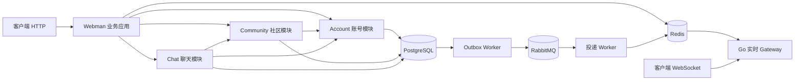

# 模块化单体改造方案

日期：2026-10-30。状态：架构方向已确认，本文是待执行方案，不是完成记录。

适用项目：当前 PHP / Webman / RoadRunner + Go 实时 Gateway 后端。项目尚未上线，但已有数据库、业务实现及测试，按保留数据的增量方式改造。

## 1. 决策、范围与成功标准

采用“PHP 模块化单体 + 独立后台 Worker + Go 实时 Gateway”。PHP 业务内部优先使用本地方法调用；只有实际跨进程的边界才使用网络协议。按业务组织代码，不要求每个模块具有独立服务进程、数据库账号、RPC Client、Proto 和四层目录。

本文承接用户确认的简化方向。对 [总规范](SOCIAL_APP_BACKEND_BUILD_SPEC.md) 中以下架构要求作定向替代：

| 旧要求 | 本次替代决策 |
| --- | --- |
| 保留六个 PHP 独立核心服务 | 收敛为 Account、Community、Chat 三个进程内业务模块 |
| API Gateway 只能调用 gRPC，不能进入业务持久化路径 | Webman 成为业务应用入口，Controller 调用本地业务服务；Controller 仍不直接写 SQL |
| 所有内部同步调用必须使用 gRPC | PHP 模块之间本地调用；实际网络边界才保留 RPC 鉴权、TLS 和传输 deadline |
| 每个旧服务只访问一个 schema | 新模块可管理其拥有的两个旧 schema；其他模块通过方法协作，不能绕过归属随意读写 |
| Chat 摘要对账必须改造为 Message RPC | 合并后消息与摘要同事务更新；既有数据用一次性本地核对修复，不再新增长期对账 RPC |
| 固定 Transport → Application → Domain → Repository Interface → Infrastructure | Controller → 业务服务 → 查询／存储代码；接口和子目录按实际复杂度增加 |

身份隐私、账号安全、幂等、数据精度、消息持久化、可靠异步、输入校验和既定产品范围继续有效。审核仍暂不实现。本次不顺带改变会话复用、拉黑可见性、昵称等产品语义；总规范中尚未落实的产品要求单独跟踪，不混入架构搬迁。

本轮文档交付不启动改造、迁移、容器或数据清理。后续实施按本方案阶段推进。

最终验收的简化结果：

- PHP 核心 HTTP 请求不再调用本机／容器中的 Auth、User、Content、Social、Chat、Message gRPC 服务。
- Account、Community、Chat 可以在同一应用中运行，业务模块保留明确入口和数据归属。
- 消息、seq、会话摘要、消息 Outbox 使用同一 PostgreSQL 事务；正常发送不依赖异步摘要修复。
- 不新增通用服务总线、模块发现框架、全局 Repository 工厂或统一万能 Worker。
- 保留所需行为测试，减少仅为内部网络跳数、旧服务装配和废弃适配器服务的测试。
- 外部 API、公开投影、消息事件和历史数据在迁移期间保持兼容；确需改变的部分另列变更。
- 比较同资源、同数据、同负载下的改造前后结果，不预先承诺性能提升百分比。

## 2. 当前复杂性的来源

下列是已检查的代码入口，不是全部问题清单；开始实施时重新核对工作区版本。

| 现状 | 代码位置 | 改造目标 |
| --- | --- | --- |
| 每次受保护 HTTP 请求经 Gateway 调 Auth，再检查 User | [AuthMiddleware](../apps/api-gateway/app/Middleware/AuthMiddleware.php)、[AuthApplicationService](../services/auth-service/src/Application/Service/AuthApplicationService.php) | 保留全部认证检查，改为 Account 本地调用 |
| 发消息先向 Chat 查询成员与权限 | [MessageApplicationService](../services/message-service/src/Application/MessageApplicationService.php) | 同一 Chat 模块内执行 |
| 已读点可能反向查询 Message 最新 seq | [ChatApplicationService](../services/chat-service/src/Application/ChatApplicationService.php) | 同一模块、同一数据源读取 |
| 摘要依赖消费与后台对账 | [MessageSummaryReconciler](../services/chat-service/src/Infrastructure/MessageSummaryReconciler.php)、[恢复手册](MESSAGE_RECOVERY.md) | 发送事务更新摘要，迁移窗口核对历史 |
| Webman 装配多个业务 RPC Client | [container.php](../apps/api-gateway/config/container.php) | 装配本地业务服务 |
| Content 直接使用 PDO，Chat 从仓储取 PDO，Message 另有多套存储接口 | [ContentApplicationService](../services/content-service/src/Application/ContentApplicationService.php)、[消息存储接口目录](../services/message-service/src/Domain/Repository/) | 允许明确且简单的存储实现，不为形式一致再增加抽象 |
| 多个独立启动、健康、凭证和超时配置 | [compose.yaml](../compose.yaml)、[Makefile](../Makefile)、[环境示例](../.env.example) | 按真实运行进程保留配置 |

原有代码中的事务、权限及恢复逻辑仍有价值。不能将复杂类整体删除后用一个不处理失败的短函数替代。

## 3. 目标运行结构



图中模块到模块的箭头为进程内方法调用。Worker 到 PostgreSQL 的权限按任务限定，不使用业务应用的全量权限。

| 运行部分 | 职责 | 部署原则 |
| --- | --- | --- |
| Webman 业务应用 | HTTP 认证、三个模块、业务事务、响应 | 同一代码包可启动多个 Webman worker／副本 |
| 后台 Worker | Outbox 发布、事件投递及确有需要的异步任务 | 与应用共用代码包，使用独立启动命令和进程 |
| Go Gateway | WebSocket、票据、连接、心跳、背压、实时下行 | 独立进程，无业务 SQL |
| PostgreSQL / Redis / RabbitMQ | 事实存储、安全与实时状态、可靠异步 | 本轮保留，不同时替换基础设施 |
| RustFS / 观测设施 | 媒体与监控 | 按实际功能和 profile 启用 |

“三类运行部分”不等于只能启动三个容器。两个 Outbox Relay 与投递消费者暂时可各自运行；不为减少容器数字把不同故障与重试模型硬塞进一个循环。六个 PHP 业务服务不再分别常驻，HTTP 应用与后台任务可独立扩实例。

沿用 `apps/api-gateway` 作为过渡入口，文档中将其职责改称“业务应用”。目录名可以在最终清理阶段决定是否改为 `apps/backend`，不作为迁移前置条件，不与外部 URL 变化绑定。

## 4. 模块边界与依赖方向

| 模块 | 合并来源 | 拥有的数据 | 对外提供的方法类别 |
| --- | --- | --- | --- |
| Account | Auth + User | auth_db、user_db | 登录、刷新、注销、设备、账号状态、身份授权、公开 MAIN 查询、票据签发 |
| Community | Content + Social | content_db、social_db | 帖子评论、公开列表、本人管理、点赞关注、双向拉黑、匿名来源解析 |
| Chat | Chat + Message | chat_db、message_db | 会话、成员快照、消息发送、历史／同步、已读点、摘要 |

依赖方向固定为：Account 不依赖 Community / Chat；Community 可调用 Account；Chat 可调用 Account 与 Community。不建立模块相互回调的隐藏环路。

模块可暴露普通的具体业务服务，不强制每个入口额外建立 FacadeInterface。跨模块数据尽量返回小型只读结果；不返回可被其他模块调用 `save()` 的 Eloquent 模型、数据库连接或可任意修改的实体。

`Account` 的账号与身份授权属于一个领域内的不同职责；`Chat` 的会话管理与消息持久化也可保留多个类，不合成一个巨型 Service。

`Community` 提供“检查双方是否拉黑”“解析可访问内容的作者目标”等明确方法。Chat 不自行查询 content_db / social_db，不通过公共匿名 DTO 推导内部账号。

模块内允许必要 JOIN 和单事务更新两个旧 schema。模块之间优先通过入口方法协作，不以一个大 JOIN 串起所有业务；确有跨模块写事务需求时，先明确业务协调者、参与连接与锁顺序，不默认发明跨模块事务框架。本次核心迁移不引入新的跨模块原子写入。

## 5. 目标目录与代码约定

以下为建议的新目录；实施前不存在的文件均为拟新增，不代表已实现：

```text
apps/api-gateway/
  app/Controller/              # 保留 HTTP 契约与参数转换
  app/Middleware/              # 认证、限流、追踪、响应边界
  config/container.php         # 显式装配本地模块

modules/
  Account/
    AuthService.php
    UserService.php
    PersonaService.php
    Storage/                   # 需要独立维护的查询／持久化
    OAuth/                     # 外部供应商边界
  Community/
    PostService.php
    CommentService.php
    SocialService.php
    Storage/
  Chat/
    ConversationService.php
    MessageService.php
    ChatStore.php              # 消息事务与查询的明确存储边界

workers/
  user-outbox.php
  message-outbox.php
  message-delivery.php

packages/php/                  # 保留已有通用能力，不重建框架
contracts/                     # 外部／事件／实际跨进程契约
database/postgresql/migrations/
gateways/realtime-gateway/
tests/
```

落地约定：

1. 先复用原有类和算法，完成本地调用；路径搬迁和命名清理单独提交，避免难以审查的大范围混合改动。
2. 业务逻辑集中到相应业务服务；Controller 只验证请求形状、取得可信 Actor、调用业务和构造响应。
3. SQL 较少且只服务单个用例时可留在明确的业务实现中；查询多、并发逻辑复杂或复用时提取具体 Storage 类。不以每张表一个 Repository 作为硬性标准。
4. 接口优先保留在外部 OAuth、时钟／ID 的确定性测试、真正不同实现和复杂事务故障注入等有实际收益的边界。只转发一次方法的内部接口逐项合并，不批量机械删除。
5. 不强制为每个请求建立 Command、Handler、DTO、Mapper 四个新文件。跨多个函数的稳定数据可以用小型 DTO；局部简单值用显式参数或有静态类型说明的数组。
6. 不同时重写所有 Eloquent 为 PDO，或所有 PDO 为 Eloquent。消息的 JSONB、锁、精确比较继续使用已有 PostgreSQL 能力；用户相关 Eloquent 代码先保留。
7. 不引入事件总线替代本地方法。异步只用于必须异步或需要可靠恢复的副作用。

## 6. 数据库与权限：保留表，调整所有权

### 6.1 不在本轮搬表

保留现有六个 schema、表名、主键、seq、身份快照、事件 ID 与 Phinx 历史。先在逻辑上由三个模块各拥有两个 schema，不合并表、不重新生成 ID、不重写历史匿名标识。

新增 `backend_runtime` 是目标角色名称，实施时通过增量角色初始化／迁移加入；当前尚不存在。它获得三个模块实际操作所需的表级权限，权限并集以现有运行时角色为起点逐项列出，不授予数据库所有者、超级用户或 DDL。消息正文继续限制为读取／插入，不因合并扩大为任意更新／删除。

业务应用内由代码模块边界限制数据访问。**同一进程中的模块不再具有原六服务各自的数据库凭证隔离**，这是换取部署与调用简单性的明确取舍；不能继续宣称同进程内具有独立服务级安全隔离。暴露公共接口时的授权、匿名隐私与输入校验没有减弱。

Worker 使用单独角色：Relay 只领取／更新对应 Outbox；投递任务按需读取成员／权限或调用已抽取的本地业务能力，并获得经过清单审核的只读权限，不继承 backend_runtime。迁移继续使用 migration_ddl，管理员凭据只在初始化路径使用。

SQL 使用明确的 schema 限定名或固定且可审查的连接配置。不能在常驻进程里按请求动态切换 search_path，尤其不能因多个 schema 均有 outbox_events 等同名表而写错归属。

### 6.2 一个事务必须是一条实际连接

Chat 的消息、seq、摘要和 Outbox 必须使用同一个 PDO 连接，不是“两个连接都调用 beginTransaction”。合并 Account 后如建立跨 auth_db / user_db 的新原子操作，同样要求底层同一连接；Eloquent 与原生 PDO 混用时须证明共享事务，不能依赖容器对象名字相同。

本轮先保持 Account 既有注册幂等流程。把注册、第三方身份映射、设备创建进一步合并事务可作为后续明确改动，不为了模块合并同时改写所有登录顺序。OAuth HTTP 调用在数据库事务外完成，避免持锁等待外部服务。

不嵌套开启未知事务，不增加隐式自动重试装饰器。沿用明确的 PostgreSQL 错误分类：已回滚事务可有限重试；提交结果未知不能重复执行写回调。

## 7. 第一优先：合并 Chat 与 Message

### 7.1 本地授权与读取

原 Message → Chat 成员快照调用改为 `ConversationService` 本地方法；原 Chat → Message 最新 seq 调用改为 ChatStore 查询。原 User、Social 依赖可暂用已有适配器，待后续阶段替换，不为过渡新建通用 LocalOrRemote 调度框架。

保持账号有效性、成员归属、固定身份、双向拉黑、幂等查询授权和公开投影检查。不能以“已在 HTTP 验过 Token”为由跳过会话权限。

### 7.2 目标发送事务

```text
验证请求、可信 Actor 与当前会话权限
查询发送者级幂等记录，匹配则返回原结果
BEGIN（同一连接）
  再次处理并发幂等竞争
  锁定并递增 conversation_sequences
  插入 messages，保持原身份快照和精确 JSONB 语义
  按 seq 更新 chat_db 会话摘要
  插入原格式 message.created.v1 Outbox
COMMIT
返回持久化 ACK
```

会话摘要更新包含当前实际需要的 last_message_id、last_message_seq、last_message_at 等字段，以实际 schema 为准。统一所有写路径的锁顺序；历史摘要回填、消费者残留更新、已读写入与新发送并发都要验证，避免两套反向锁序形成死锁。

并发幂等冲突发生后回滚本事务，再读取已提交原结果，核对全部业务载荷；不能在 PostgreSQL 已失败事务上继续查询。重复请求不产生第二条消息／事件、不重复推进 seq 或摘要。

事务任何一步失败整体回滚。提交确认丢失后以原幂等键恢复，不能假设消息存在而摘要未提交。发送者级 `(sender_user_id, client_message_id)` 作用域保持不变。

### 7.3 摘要消费者和对账的退出

合并不是删除整条消息事件链。现有消费者承担的在线投递继续保留，只退出不再需要的摘要写入部分：

1. 切换前暂停聊天写入，记录旧 Outbox、主队列、retry／recovery／invalid／failed 的数量与处理状态。
2. 对所有存量会话核对摘要与已提交最大 seq；运行一次受控修复，并记录差异和结果。无消息会话也要检查，不能只处理能 JOIN 到最新消息的行。
3. 部署同事务摘要写入及兼容旧事件的投递逻辑。原消费者暂保留幂等摘要更新时，只允许按 seq 前进，不能覆盖新摘要。
4. 确认所有消息写入口均已切换，旧事件消费／隔离情况已记录，再移除消费者中的摘要写分支。
5. 停止 `chat-message-reconciler` 常驻循环；必要时保留显式的一次性诊断／修复命令，不能将它作为正常写入正确性的依赖。

旧队列不能因“重构完成”直接删除。重试／隔离事件仍使用原 event_id，投递至少一次的重复语义仍需客户端去重；jobs.failed 中的审计副本不自动重放。未清空的失败事件带着明确处置记录迁移。

### 7.4 存储抽象的收敛

目标优先采用一个具体 `ChatStore` 承载消息读写与发送事务。只有故障注入确需替身时保留一个窄接口；不同时要求 Repository、TransactionManager 和 WriteTransaction 三套公共抽象。

先保证原有提交未知、锁超时、并发唯一约束、精确 JSONB、Outbox 租约测试通过，再合并接口。涉及未知提交的恢复逻辑不能被普通 `PDO::transaction` 包装替换掉；若保留独立事务执行器更清晰，则保留它，但缩小为存储内部实现，不强求删除文件数量。

## 8. 第二优先：合并 Auth 与 User

Webman `AuthMiddleware` 调 Account 本地 `verifyToken`，后者使用本地账号／设备查询。保留以下语义：

- JWT 验签、有效期、设备归属、Token／设备撤销、账号状态。
- 账号删除／封禁立即影响新请求；依赖不可用返回服务不可用，不能误报凭证失效。
- 注册原子创建 MAIN／canonical ALIAS 的规则、注册幂等和身份停用不能自动复活。
- 刷新、设备注销、首次撤销时间、微秒精度、部分失败后的幂等收尾。
- OAuth provider 校验、绑定目标来自认证上下文、生产禁用开发手机号登录。

Account 的内部 UserDirectory gRPC 适配可由现有接口的本地实现过渡；所有调用者切换后，若接口只剩一次无价值转发，再合并成直接依赖。不在每次请求中通过配置临时决定 local／remote。

可信请求上下文显式传入业务方法；不把 TraceContext 中的 user_id 当唯一授权来源。Webman 的 singleton 不得持有上一请求的 Actor、事务或可变认证结果；请求结束清理上下文和未结束事务。Worker 采用独立任务上下文，不伪造万能管理员账号调用所有业务方法。

数据库和 OAuth 现在进入 Webman worker，需配置有界连接／请求超时、worker 数量和总 DB 连接预算。不能假设把同步 RPC 换成同步 PDO 后自动获得异步并发能力。先采用现有进程模型测量，再决定是否需要池化，不为预期性能另建一套连接池框架。

## 9. 第三优先：合并 Content 与 Social

Controller 直接调用 Community 的 PostService、CommentService、SocialService。帖子查询中的拉黑过滤使用模块内部查询；保留批量检查和有界候选扫描，不能从一个批量 RPC 改成 N 次本地 SQL。

点赞、评论计数等 Community 内部一致性可在实际需要的用例中使用同连接事务；先保持已有行为，再单独收敛重复事件／回写流程，不一次改掉所有计数策略。

继续保留：同帖身份锁定、匿名昵称冻结、作者投影、真身主页不显示匿名内容、本人管理权限、游标分页、删除与双向拉黑过滤。Feed 仍是当前板块查询，不借重构增加推荐服务。

Chat 调用 Community 的拉黑／来源解析入口；Community 调 Account 的身份授权入口。业务模块不能自行 new 另一个模块的 Repository 或写它的表。

## 10. API、DTO 与 gRPC 的处理

### 10.1 外部契约先不动

保持已有 HTTP URL、参数、状态码、错误码、公开字段、ID 字符串、时间精度、分页和 JSONB 语义。当前尚未实现的功能不在重构期间新增假成功响应。

将旧应用服务返回的 Protobuf 类型转换为内部普通结果时，以快照／契约测试逐字段比对：默认值、空数组／空对象、null、枚举整数、64 位 ID 和匿名隐藏字段都要保持。公开数据仍有统一投影入口，不能为了少一个 Mapper 直接返回数据库行。

过渡期允许原应用服务继续返回既有 Public* 类型。先移除内部网络，再逐步清理传输耦合；不把全部 DTO 重写作为第一阶段前置条件。

### 10.2 PHP 内部 RPC 的退出

每移除一个 RPC，先列出所有运行时调用方、CLI／探针、Worker、测试和生成消费者；本地替换后再删除服务端、客户端、token、环境变量、容器和测试装配。

尚有旧调用者时可保留一个薄兼容端点，内部调用同一份新模块业务代码。不得复制两份业务逻辑或长期同时维护 local／remote 两套实现。每个兼容端点有明确的退出阶段。

不要为保证旧测试还能发 RPC 而永久保留六个服务器；相关测试改为业务／HTTP 边界测试。确有跨进程消费者的契约另行保留，不能通过删测试掩盖实际调用断裂。

### 10.3 Go Gateway 边界

当前先保持 HTTP 发送消息、Redis 下行提示、HTTP 历史／同步。不为了保留 gRPC 新建一个暂时没有调用方的 PHP 服务。

如果后续启用 WebSocket 上行，再建立最小的跨语言适配入口，复用 Chat 业务服务，按真实边界保留认证、TLS、超时和 Proto。Go Gateway 仍不得直接访问 PostgreSQL，也不自行执行身份和消息事务逻辑。

RoadRunner、PHP gRPC 扩展与生成依赖只在确认没有实际运行调用方后退出默认运行镜像；仍需生成外部协议时保留独立工具镜像。不得同时删除 Go 正在使用的生成类型和事件公开结构。

## 11. Worker、Outbox 与重试范围

沿用已有 User／Message Outbox 表、事件名称和 event_id，先搬入口不合并物理表。两个 Relay 使用相同代码包但明确各自表和凭证。RabbitMQ 拓扑在第一轮不替换为另一套队列方案。

投递 Worker 不再承担聊天主数据的最终一致性，保留异步投递、必要的当前权限复核、去重和失败恢复。读取成员／状态的代码可复用本地模块能力，但凭证只授予该任务必要权限；不能因为 Worker 无 HTTP 认证就跳过任务来源和载荷校验。

总规范中的有界重试／隔离要求继续作为独立可靠性任务。若本轮只搬入口且未改重试算法，必须注明旧的持续回流仍未整改，不能声称改造自然修复它。实现重试整改时保留原事件 ID、预算、转存确认和人工恢复路径，不清空历史积压。

无需新增同步事件总线来更新本模块摘要或计数。数据库已能保证的同事务一致性直接使用事务；对外部系统的副作用继续通过 Outbox。

## 12. 配置、进程和可观测性收敛

| 项目 | 目标 |
| --- | --- |
| Compose | 默认启动 Webman 应用、必要 Worker、Go Gateway 和基础设施；移除无调用方的六服务容器 |
| 数据库配置 | 应用统一 backend_runtime；Worker 保留限定角色；迁移账号继续独立 |
| INTERNAL_RPC_* | PHP 本地边界的 token 随调用退出删除；实际网络边界按需保留 |
| GRPC_* | 删除已消失的内部地址／单跳预算；保留真实 RPC 的配置 |
| 请求预算 | HTTP 总预算、SQL／锁／OAuth／Redis 的实际 IO 超时；本地方法不再模拟网络 deadline metadata |
| 健康检查 | 应用直接检查关键依赖和自身状态；不再 RPC 探活同一业务应用中的模块 |
| 日志／追踪 | 保留 request_id／trace_id，增加稳定 module 标签；删除不存在的网络 hop 指标 |
| ID 租约 | 迁移到 Webman／Worker 生命周期，保持每进程独占及空闲续约，不以静态 worker_id 代替 |

可复用现有 OperationBudget 约束一条业务操作的剩余 IO 时间；不要因为调用变成本地就删除 SQL 锁等待、外部 OAuth 和后台任务的上限。

数据库连接断开后重建，不能自动重放结果未知的写操作。常驻 worker 退出／重启释放或失效事务、连接和租约；空闲超过 TTL、进程暂停恢复、并发多 worker 发号都需要实际测试。

请求链路从“远程健康”改为本地不表示所有依赖共用同一个健康判定。比如 RabbitMQ 暂时不可用时，已经可靠写入数据库 Outbox 的请求可按既定策略处理；不能把健康检查设计成不必要的全站故障放大器。

## 13. 实施阶段与出口

每个阶段包含实现、必要测试和文档更新，以可独立审查的提交推进。阶段内的文件搬迁、行为变化和删除分别组织，不以一个大提交完成全部迁移。

### M0：基线与改造准备

任务：记录当前 commit／工作区差异、容器拓扑、活跃 RPC、API 示例、数据库角色及队列积压；在独立环境建立数据副本，运行核心测试和 HTTP／消息延迟基准。记录已有失败／跳过，不把它们当本轮新回归，也不宣称基线全绿。

建立本地模块装配入口、目标角色和三模块命名约定。只新增必要基础，不预创建所有类或通用框架。核对旧服务当前没有跨库事务后，为 Chat 明确同连接装配。

出口：基线记录可复现，备份可读取，外部契约测试就绪，现存阻断项有清单。数据库角色迁移可重复执行，不改动业务数据。

### M1：Chat／Message 本地化与事务合并

任务：迁入 Chat 模块，替换双向 RPC；统一消息与摘要事务；完成旧摘要核对和事件兼容；HTTP 消息／会话入口切换到本地；旧 Account／Community RPC 依赖暂保留。

切换采用受控停写和单一路由，不让同一请求同时写新旧路径，不做影子写入。所有消息写入口及后台写入者列入切换清单。旧服务如需兼容只调用同一业务实现，不能仍按旧方式独立写消息。

出口：聊天正常流无 Chat↔Message RPC，消息事务覆盖摘要；并发幂等、提交未知、历史同步、隐私与投递通过。历史摘要修复记录可核对，周期对账已不承担正确性保障。

### M2：Account 本地化

任务：迁入认证、账号、Persona；AuthMiddleware 和 Chat 身份检查改为本地调用；继续保留必要旧端点供尚未迁移的 Community 调用。迁移 ID 租约、连接恢复与请求上下文生命周期。

出口：普通 HTTP 鉴权无 Gateway→Auth→User 网络链路；登录／刷新／注销／禁用／匿名身份测试通过。重启、空闲和请求串扰验证通过，不为性能牺牲实时权限检查。

### M3：Community 本地化

任务：迁入内容和关系；批量拉黑查询本地化；Chat 来源解析本地化；所有 HTTP Controller 装配本地服务。逐项退出最后的 PHP 内部 RPC 调用。

出口：核心 HTTP 请求的 PHP 业务调用均在本地完成；身份、板块、同帖锁定、互动、游标和授权行为不回归。没有因改成本地增加 N+1 SQL。

### M4：Worker 与部署清理

任务：迁移 Worker 入口和限定权限，移除摘要消费者分支／常驻对账；删已无调用者的 RPC client／server、凭证、健康探针、Compose 服务；按真实依赖决定是否移除 RoadRunner 和 PHP gRPC 运行时。

出口：默认部署不再需要六个独立 PHP 业务服务；旧消息积压、隔离和审计状态可追溯；重启恢复、发布失败、重复投递测试通过。没有只为旧测试启动的业务 RPC 服务。

### M5：代码与文档收尾

任务：清理临时适配器，收敛无价值接口，按实际需要移出内部 Protobuf；调整 autoload、静态分析和测试入口；完成同资源前后对比与部署回退演练。

出口：无双份业务实现、无隐式旧服务依赖；新开发环境和已有卷升级均可用；新文档能直接说明真实路径。性能未达预期先定位瓶颈，不直接以重新拆微服务作为默认补救。

## 14. 文件级改动清单

| 文件／目录 | 计划改动 | 删除条件 |
| --- | --- | --- |
| apps/api-gateway/app/Controller、Middleware | 改为本地模块依赖，保持 HTTP 契约 | 不删除仍需的授权／限流 |
| apps/api-gateway/config/container.php | 装配模块、DB、请求上下文 | RPC 绑定无调用方后移除 |
| apps/api-gateway/app/Grpc | 分阶段退出内部客户端 | 业务、CLI、Worker、测试调用全部替换 |
| services/{auth,user,content,social,chat,message}-service/src | 分别迁入 Account／Community／Chat，先复用后精简 | 全部入口指向新模块后删除旧副本 |
| services/*/bin、RoadRunner 配置 | 旧业务 server 下线，Worker 迁到 workers | 默认部署与兼容调用均已退出 |
| modules/、workers/ | 新模块与后台入口，按阶段新增 | 不创建空壳占位服务 |
| packages/php/database、identity、outbox、id-generator | 复用并调整真实需要的连接、事务、快照、租约 | 不按“单体”名义删可靠性机制 |
| packages/php/grpc-common | 将仍用的业务上下文／预算移至合适通用位置 | 只删除纯传输且无实际调用的代码 |
| database/postgresql/migrations/ | 添加角色／必要约束，保留旧迁移历史 | 不重写已应用版本 |
| infra/docker/postgresql/init/ | 新卷与已有卷都能配置目标角色 | 最后调用退出后撤销旧运行时角色权限 |
| compose.yaml、Makefile、scripts/ | 更新默认启动、迁移、测试和探针 | 未清空旧队列／状态前不移除恢复入口 |
| composer.json、镜像构建、CI | 更新 autoload 和真实运行依赖 | 无调用、可构建、验证完成后再减依赖 |
| contracts/proto、gen、events、errors | 保留外部／事件使用部分，清理纯内部遗留 | 先确认 Go、任务和外部消费者；生成文件由工具重建 |
| tests/ | 调整业务和边界测试，保留并发／恢复证据 | 只删除已退出的网络装配测试，不降低行为覆盖 |

## 15. 验证矩阵

| 范围 | 必测场景 | 通过标准 |
| --- | --- | --- |
| 外部兼容 | 同请求的状态码、错误码、默认值、JSON 类型、分页、消息正文 | 无未声明差异，匿名字段无泄漏 |
| 账号与设备 | OAuth 并发注册、刷新竞争、设备隔离、注销部分失败与重试 | 原安全语义保持，MAIN／ALIAS 不重复创建 |
| 内容与关系 | 同帖并发参与、昵称锁定、双向拉黑、主页／本人管理、全过滤空页 | 权限和分页一致，无 N+1 查询回退 |
| 聊天持久化 | 同键同载荷、同键异载荷、同键跨会话、并发 seq、摘要更新失败 | 唯一性成立，消息／seq／摘要／Outbox 原子提交或回滚 |
| 提交未知 | 真实提交后隐藏确认，再用原幂等键恢复 | 一条消息、一条事件、正确摘要，不重复写回调 |
| 历史与迁移 | 空会话、旧摘要落后／错误、旧未发事件、retry／隔离队列 | ID／seq／快照不变，差异可核对，旧事件仍可处理 |
| 实时提示 | 重复事件、订阅中断、重连补拉、多个设备 | 不依赖提示保证消息完整，客户端可恢复并去重 |
| 常驻进程 | A／B 用户连续请求、异常回滚、DB 重连、空闲／暂停／重启 | 无身份串扰、无悬挂事务、无失租约继续发号 |
| 权限 | backend_runtime、Relay、投递、迁移角色分别验证 | 运行时无 DDL，Worker 无无关业务写权限 |
| 部署 | 新环境、已有卷、协调切换、回退 | 不清空数据，只有一个有效业务写路径 |

复用现有 [PostgresMessagePersistenceTest](../tests/Integration/PostgresMessagePersistenceTest.php)、[ContentBoardsTest](../tests/Integration/ContentBoardsTest.php)、[ContentAuthorizationTest](../tests/Integration/ContentAuthorizationTest.php) 等有业务价值的用例，按新装配改造。SQLite／内存替身不能替代 PostgreSQL 锁、事务和 JSONB 验证。

现有 Make 命令作为阶段起点，实施中同步更新其内部路径：

```bash
make lint
make analyse
make test
make test-integration
make test-postgres
make test-message
make e2e
```

集成测试必须使用独立 `test_*` 数据库和隔离 Redis／RabbitMQ，核对容器实际收到测试配置；不向开发数据执行清表测试。旧 gRPC 专用测试在端点退出前仍应运行，退出后用相应 HTTP／模块行为测试接替。缺依赖跳过必须报告。

前后对比至少包含鉴权读请求、板块列表、发消息／同步：记录 HTTP P50/P95/P99、SQL 次数、连接数、PHP worker 数、内存、吞吐、错误率、RPC 调用次数和队列积压。认证与消息核心路径的 PHP 内部 RPC 次数最终应为零；不要用不同数据量或少做权限校验制造提速结果。

## 16. 切换与回退

### 16.1 每阶段切换

1. 保存当前代码版本、环境和数据库／队列状态；确认没有把他人的未提交改动混入迁移。
2. 停止该阶段相关写入口、旧进程与会修改目标数据的任务，等待在途请求结束。
3. 应用增量角色／schema 变更，完成历史核对或回填；不把回填与无界正常流量并行。
4. 启动新路径，先验证认证、权限、写入与恢复，再恢复流量和必要消费者。
5. 核对新旧幂等键、事件 ID、seq 和摘要，观察错误／连接／积压；满足出口后再清理旧路径。

配置只在部署时选定实现，不提供普通用户可触发的按请求新旧切换。禁止一边保留旧独立服务写入，一边启用新的本地事务，而没有明确单写控制。

### 16.2 回退边界

第一轮不改表名和外部事件，便于代码回退，但不能只换镜像就假定安全。必须先停止新写入，核对数据仍满足旧代码假设，再恢复旧凭证、容器、消费者与拓扑；新增事务内摘要应与旧幂等摘要更新兼容。

旧消费者恢复时不得重复把审计副本当业务事件投递。仍待发布的 Outbox 保留原 ID 和状态；新旧 Relay 不争抢使用不兼容的租约格式。

角色撤销、内部协议删除、摘要消费者永久移除等清理分离到已验收之后。进入不可逆数据／协议变更后，回退必须有专门适配或已验证备份恢复方案；优先前向修复，不用删除数据卷“恢复”。

## 17. 文档同步与关闭条件

总规范本轮先增加明确的架构覆盖说明和方案链接；实施完成时再把相关正文改成真实单体路径，移除已完成的过渡说明。不要一边保留“所有内部调用必须 gRPC”，一边要求开发者自行猜测例外。

各阶段同步更新根 README、相关服务／模块 README、[消息存储手册](POSTGRESQL_MESSAGE_STORAGE.md)、[消息恢复手册](MESSAGE_RECOVERY.md)、[运行时说明](RUNTIME_RESILIENCE.md) 和 [身份迁移说明](PERSONA_IDENTITY_MIGRATION.md)。旧验收记录保留日期，不篡改成新架构已经通过。

完成清单：

- [ ] Account／Community／Chat 由同一业务应用装配，核心 PHP 调用本地化。
- [ ] 数据归属明确，Chat 四类写入使用同连接事务。
- [ ] 外部契约、账号安全、匿名隔离和历史数据保持。
- [ ] 摘要不再依赖异步回写／周期修复；旧事件积压有处置结果。
- [ ] 内部 RPC、凭证和旧进程按真实调用退出，没有双份业务代码。
- [ ] Webman／Worker 请求生命周期、连接恢复与 ID 租约验证完成。
- [ ] 必要测试、隔离环境 E2E、同资源前后对比与回退演练完成。
- [ ] 目录、依赖、部署、配置、测试和文档均与最终结构一致。

本方案以减少必要变更所需的跳转、网络边界和配置为目标。不是所有接口都要删除，也不是所有数据都应揉进一个类；优先让一次业务操作的权限、事务和失败处理可以在少量相邻代码中看清。
